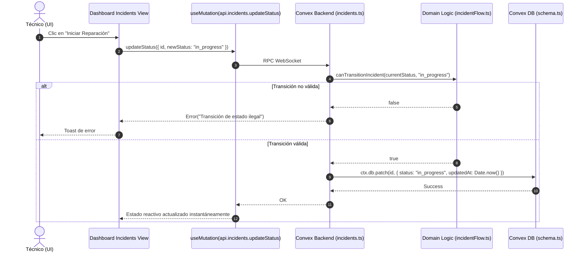

# Arquitectura del Sistema Pulso Taller (`GestMant_TS`)

## 1. Visión General y Estilo Arquitectónico
El sistema combina los principios de **Clean Architecture** (separación estricta del dominio puro respecto a la infraestructura y frameworks) con un backend reactivo serverless basado en **Convex** y una interfaz SPA en **React 19**.

```
+-----------------------------------------------------------------------------------+
|                           PRESENTACIÓN (SPA React 19)                            |
|  src/pages/dashboard/* (incidents, requests, equipment, settings, etc.)           |
|  src/components/ui/* (Radix UI, Tailwind CSS v4, Lucide icons)                    |
+-----------------------------------------+-----------------------------------------+
                                          |
                      Llama Hooks / CQS   | Invoca utilidades puras
                                          v
+-----------------------------------------+-----------------------------------------+
|                  BACKEND REACTIVO (Convex Serverless)                             |
|  src/convex/* (schema.ts, mutations, queries, actions, auth.ts)                   |
|  - CQS (Command Query Separation) reactivo sobre WebSockets                        |
|  - Trazabilidad y validaciones antes de persistir                                |
+-----------------------------------------+-----------------------------------------+
                                          |
                      Valida transiciones | Invoca reglas de negocio
                                          v
+-----------------------------------------------------------------------------------+
|                         NÚCLEO DE DOMINIO PURO (Clean Core)                       |
|  src/lib/* (incidentFlow.ts, requestFlow.ts, purchaseFlow.ts, richDoc, pdf)       |
|  - CERO dependencias de React, DOM o Convex                                      |
|  - Determinista, testeable al 100% en memoria con Vitest                          |
+-----------------------------------------------------------------------------------+
```

---

## 2. Mapa y Responsabilidad de Módulos

### `src/lib/` (Capa de Dominio Puro)
- **Propósito:** Aloja la lógica de negocio central, cálculos, máquinas de estado y generadores de documentos.
- **Submódulos Clave:**
  - `incidentFlow.ts`: Máquina de estados finita de Incidencias (`reported`, `assigned_onsite`, `assigned_workshop`, `in_progress`, `resolved`, `unresolved`, `archived`).
  - `requestFlow.ts`: Máquina de estados de Peticiones de Repuesto (`draft`, `pending`, `approved`, `rejected`, `ordered`, `received`, `issued`, `archived`).
  - `purchaseFlow.ts`: Máquina de estados de Órdenes de Compra (`pending`, `ordered`, `received`).
  - `pdf.ts` & `reportPdf/`: Generación de informes PDF y partes de trabajo.
  - `richDoc/`: Transformadores de documentos enriquecidos (TipTap JSON <-> Texto plano).
  - `weeklyReport/`: Agregación y métricas de informes semanales.
- **Regla Inviolable:** No puede importar `@convex-dev/*`, `convex/*`, `react` o `react-dom`.

### `src/convex/` (Capa de Backend Serverless / Infraestructura de Datos)
- **Propósito:** Persistencia reactiva en base de datos Convex, autorización y endpoints.
- **Archivos Clave:**
  - `schema.ts`: Definición de tablas (`incidents`, `spare_parts`, `requests`, `equipment`, `purchase_orders`, etc.), índices y restricciones.
  - `auth.ts`: Configuración de autenticación (@convex-dev/auth).
  - Archivos de módulo (`incidents.ts`, `requests.ts`, `equipment.ts`, `purchaseOrders.ts`): Queries (lectura) y Mutations (escritura).
- **Regla Inviolable:** Las mutations que cambien estados deben validar la transición ejecutando las funciones de `src/lib/*Flow.ts`.

### `src/pages/dashboard/` (Capa de Presentación / Vistas de Funcionalidad)
- **Propósito:** Vistas del panel de control organizadas por bounded context:
  - `incidents/`: Listado, detalle, filtros y diálogo de creación de incidencias.
  - `requests/`: Flujo de peticiones de repuesto, diálogo de petición (`dialogs/`), componentes (`components/`), tabla (`RequestsTable.tsx`).
  - `equipment/`: Gestión de equipos, filtros (`EquipmentFilters.tsx`), diálogo (`dialogs/EquipmentFormDialog.tsx`), mantenimiento preventivo (`dialogs/MaintenanceDialog.tsx`), componentes de fila (`components/ManualRow.tsx`, `ComponentRow.tsx`), helpers y tipos.
  - `settings/`: Configuración del taller, usuarios y almacén.
- **Regla Inviolable:** Mantener los componentes de vista limpios delegando lógica compleja a subdirectorios `dialogs/`, `components/`, `hooks/`, `helpers.ts` y `types.ts`.

### `src/components/ui/` (Design System Base)
- **Propósito:** Componentes UI reutilizables y accesibles construidos sobre Radix UI y Tailwind CSS v4 (`button.tsx`, `dialog.tsx`, `table.tsx`, `badge.tsx`, `input.tsx`, etc.).

---

## 3. Flujo de Datos Típico (Ejemplo: Transición de Estado de una Incidencia)



---

## 4. Invariantes Arquitectónicas Verificadas por Tests

El archivo `tests/arquitectura.test.ts` implementa aserciones estáticas que se ejecutan en cada build:
1. **Aislamiento del Dominio:**
   Ningún fichero en `src/lib/**/*.ts` puede tener declaraciones `import ... from 'convex'` o `import ... from 'react'`.
2. **Registro de Funciones de Backend:**
   Cada archivo `.ts` en `src/convex/` debe cumplir las convenciones de nombres de Convex y estar tipado contra `_generated/dataModel`.
3. **Desacoplamiento UI:**
   Las páginas de dashboard no deben instanciar mutaciones directas de bajo nivel sin validar esquemas de formulario o pasar por los diálogos especializados.
