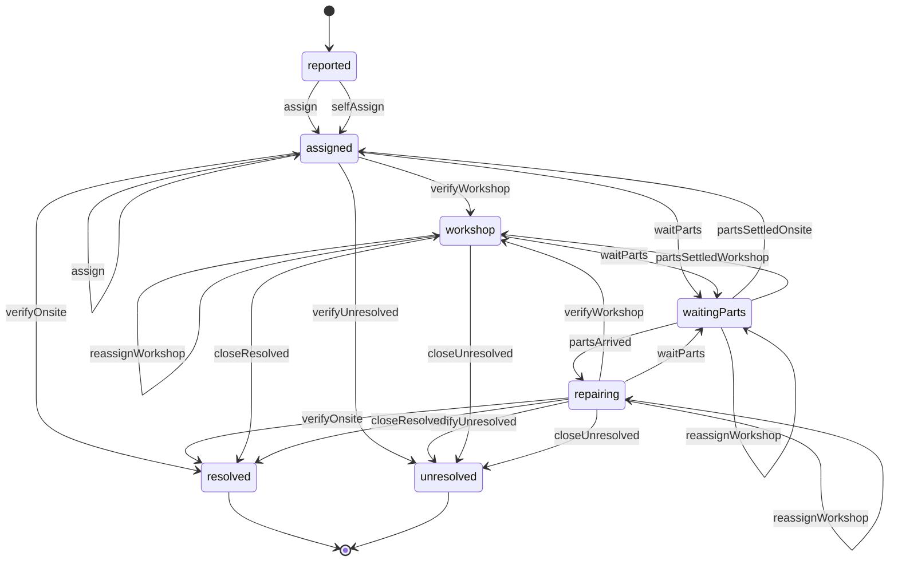
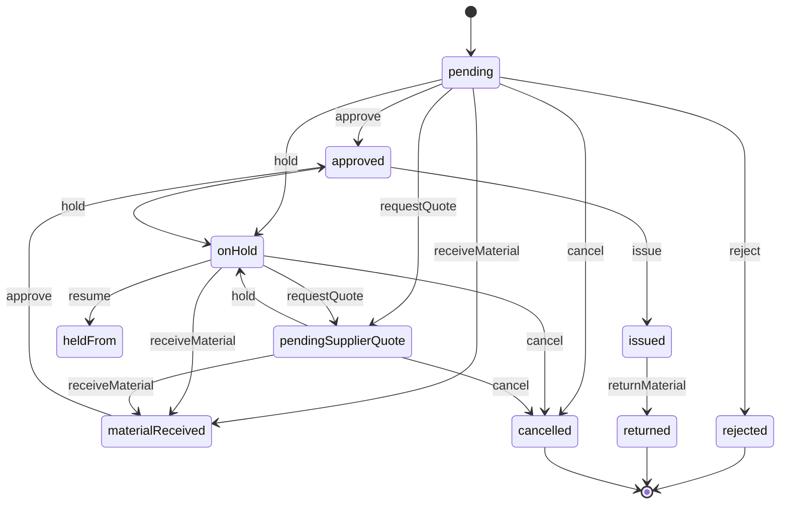
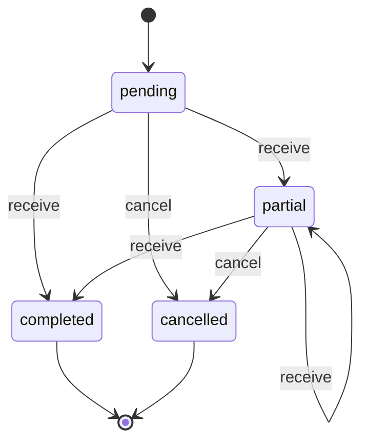

# Especificaciones de Dominio y Contratos de API (`.context/specifications.md`)

## 1. Vocabulario Ubicuo del Dominio (`GLOSARIO.md`)

Para mantener la coherencia conceptual del negocio, se aplican estrictamente estas definiciones:

| Término Canónico | Definición de Negocio | Términos Prohibidos (Sinónimos Incorrectos) |
|---|---|---|
| **Incidencia** | Suceso que afecta al funcionamiento normal de un equipo que requiere intervención técnica. | *Ticket*, *avería*, *fallo*, *problema* |
| **Equipo** | Máquina o instalación individual inventariada con número de serie y mantenimientos asociados. | *Máquina*, *aparato*, *dispositivo* |
| **Repuesto** | Pieza o componente fungible utilizado para reparar o mantener un equipo. | *Material*, *consumible*, *pieza suelta* |
| **Petición de repuesto** | Solicitud formal de uno o varios repuestos para una incidencia o stock. | *Pedido interno*, *solicitud de material* |
| **Orden de compra** | Documento mercantil enviado a un proveedor para la adquisición de repuestos. | *Pedido de compra*, *PO*, *albarán* |
| **Parte de trabajo** | Registro técnico de tiempos, acciones realizadas y piezas sustituidas en una incidencia. | *Informe de servicio*, *albarán de trabajo* |
| **Técnico** | Usuario cualificado que ejecuta diagnósticos, reparaciones y mantenimientos. | *Operario*, *mecánico*, *obrero* |

---

## 2. Máquinas de Estado del Sistema (`MAQUINAS.md` & `src/lib/`)

### A. Flujo de Incidencias (`src/lib/incidentFlow.ts`)

El ciclo tiene **siete estados** y **doce pasos**, y ninguna transición se escribe
en otro sitio: la tabla que manda es `INCIDENT_STEPS`, tipada con todos los pasos y
todos los estados —un paso sin decidir por dónde pasa, o un estado al que nadie
llega, no compila—. El backend la consulta con `canAdvanceIncident` y la ficha
pregunta por ella qué botón ofrecer y por qué no, en vez de comparar estados a
mano. **Quién** puede dar cada paso está en `MAQUINAS.md`; este apartado cuenta
solo de dónde a dónde va el caso, que es lo que lee `tests/especificaciones.test.ts`
contra el código.

Dos cosas que el dibujo deja fuera a propósito. Un caso cerrado —`resolved` o
`unresolved`— **no se reabre** desde la máquina: volver a por él es una incidencia
nueva, que deja su propio rastro. Y «archivada» **no es un estado**: es lo que se
hace después con lo cerrado (`lib/archive`), y por eso no aparece aquí ni cuenta
como paso del ciclo.

El estado dice qué le pasa al caso, no dónde está el equipo: `waitingParts` y
`repairing` pueden ocurrir en el sitio o en el taller, y eso lo cuenta la entrada a
taller abierta (`isIncidentInWorkshop`). Por eso `verifyOnsite` y `closeResolved`
salen los dos desde `repairing`: el cierre lo elige `incidentCloseStep` según dónde
esté el equipo, y el backend rechaza el que no toca.

Los siete estados del ciclo son estos, con el nombre que enseña la app:

#### Estados — incident

| Estado | Nombre | Qué cuenta |
|---|---|---|
| `reported` | Nueva | Acaba de entrar, por el formulario público o por el taller: nadie la ha mirado todavía y no es de nadie. |
| `assigned` | Asignada | Tiene técnico y se trabaja en el sitio; si el equipo se deriva, pasa a `workshop`. |
| `workshop` | En taller | Entrada de incidencia a taller abierta: la lleva el técnico de taller. |
| `waitingParts` | En espera de repuestos | Tiene una petición de repuesto abierta y no se trabaja hasta que llegue el material. El sitio del equipo lo dice su entrada a taller. |
| `repairing` | En reparación | El material ya está entregado y el trabajo sigue: en el sitio o en el taller. |
| `resolved` | Resuelta | Cerrada con resolución: deja su parte de trabajo si el equipo estaba relacionado. |
| `unresolved` | Sin resolución | Cerrada sin poder resolverla. |

Los doce pasos, uno por fila:

Cada fila es una transición: desde dónde se puede dar el paso, a dónde lleva y
quién lo da. Las que comparten paso se leen juntas: `waitParts` y
`reassignWorkshop` salen de tres sitios, y `verifyOnsite`, `verifyWorkshop`,
`verifyUnresolved`, `closeResolved` y `closeUnresolved` entran desde dos.

#### Tabla de pasos — incident

| desde | paso | a | quién |
|---|---|---|---|
| `reported` | `assign` Asignar a un técnico | `assigned` | El coordinador |
| `assigned` | `assign` Asignar a un técnico | `assigned` | El coordinador |
| `reported` | `selfAssign` Autoasignarme | `assigned` | Un técnico que ve la cola |
| `assigned` | `verifyOnsite` Verificar y resolver en el sitio | `resolved` | El técnico asignado o el coordinador, con el equipo en el sitio |
| `repairing` | `verifyOnsite` Verificar y resolver en el sitio | `resolved` | El técnico asignado o el coordinador, con el equipo en el sitio |
| `assigned` | `verifyWorkshop` Verificar y derivar a taller | `workshop` | El técnico asignado o el coordinador |
| `repairing` | `verifyWorkshop` Verificar y derivar a taller | `workshop` | El técnico asignado o el coordinador |
| `assigned` | `verifyUnresolved` Verificar y cerrar sin resolución | `unresolved` | El técnico asignado o el coordinador, con el equipo en el sitio |
| `repairing` | `verifyUnresolved` Verificar y cerrar sin resolución | `unresolved` | El técnico asignado o el coordinador, con el equipo en el sitio |
| `workshop` | `reassignWorkshop` Cambiar el técnico de taller | `workshop` | El coordinador o el técnico de la orden, con el equipo en el taller |
| `waitingParts` | `reassignWorkshop` Cambiar el técnico de taller | `waitingParts` | El coordinador o el técnico de la orden, con el equipo en el taller |
| `repairing` | `reassignWorkshop` Cambiar el técnico de taller | `repairing` | El coordinador o el técnico de la orden, con el equipo en el taller |
| `assigned` | `waitParts` Quedar a la espera de repuestos | `waitingParts` | Abrir una petición de repuesto |
| `workshop` | `waitParts` Quedar a la espera de repuestos | `waitingParts` | Abrir una petición de repuesto |
| `repairing` | `waitParts` Quedar a la espera de repuestos | `waitingParts` | Abrir otra petición, o devolver material ya entregado |
| `waitingParts` | `partsArrived` Repuestos entregados | `repairing` | La entrega del material de la última petición viva |
| `waitingParts` | `partsSettledOnsite` Cerrar la espera sin material (en el sitio) | `assigned` | Rechazar, cancelar o devolver las peticiones, con la incidencia fuera de taller |
| `waitingParts` | `partsSettledWorkshop` Cerrar la espera sin material (en taller) | `workshop` | Rechazar, cancelar o devolver las peticiones, con la orden de taller abierta |
| `workshop` | `closeResolved` Cerrar como resuelta | `resolved` | El técnico que lleva el caso, al terminar el trabajo |
| `repairing` | `closeResolved` Cerrar como resuelta | `resolved` | El técnico que lleva el caso, al terminar el trabajo |
| `workshop` | `closeUnresolved` Cerrar sin resolución | `unresolved` | El técnico que lleva el caso |
| `repairing` | `closeUnresolved` Cerrar sin resolución | `unresolved` | El técnico que lleva el caso |

**Regla:** un paso solo se da si `INCIDENT_STEPS` lo admite desde el estado en el
que está la incidencia, y desde un estado cerrado no sale ninguno. La tabla de
arriba es la misma que la de `MAQUINAS.md`, contada sin la columna de permisos.

---

### B. Flujo de Peticiones de Repuesto (`src/lib/requestFlow.ts`)

Nueve estados y nueve pasos. Una petición nace **pendiente** —no hay borrador que
guardar ni estado archivado: vive en la cola hasta que se cierra en uno de sus
finales—. `onHold` recuerda de dónde salió y `resume` la devuelve allí, en vez de
dejarla siempre en «pendiente»; `requestQuote` la manda a la cola del proveedor, y
la recepción de una orden de compra la saca de ahí a **material recibido**.

#### Estados — request

| Estado | Nombre | Qué cuenta |
|---|---|---|
| `pending` | Pendiente | Recibida en la cola de repuestos, sin decisión todavía. |
| `approved` | Aprobada | Material apartado: queda entregarlo, o devolverlo. |
| `rejected` | Rechazada | Denegada; queda el motivo escrito. |
| `onHold` | En espera | Suspendida por una dependencia; guarda el estado del que salió. |
| `pendingSupplierQuote` | Presupuesto pendiente | En manos del proveedor, sin respuesta todavía. |
| `materialReceived` | Material recibido | Lo comprado ha entrado en el almacén: ya se puede aprobar. |
| `issued` | Entregada | El repuesto está en manos del técnico. |
| `returned` | Devuelta | Lo entregado volvió al almacén. |
| `cancelled` | Cancelada | Se deja sin efecto; no llegó a entregarse. |

#### Tabla de pasos — request

| desde | paso | a | quién |
|---|---|---|---|
| `pending` Pendiente | `approve` Aprobar | `approved` Aprobada | El responsable de repuestos |
| `materialReceived` Material recibido | `approve` Aprobar | `approved` Aprobada | El responsable, ya con el material en el almacén |
| `pending` Pendiente | `reject` Rechazar | `rejected` Rechazada | El responsable de repuestos |
| `pending` Pendiente | `hold` Poner en espera | `onHold` En espera | El responsable de repuestos |
| `approved` Aprobada | `hold` Poner en espera | `onHold` En espera | El responsable de repuestos; el material sigue apartado |
| `pendingSupplierQuote` Presupuesto pendiente | `hold` Poner en espera | `onHold` En espera | El responsable de repuestos |
| `onHold` En espera | `resume` Reanudar | `heldFrom` vuelve al estado del que salió | El responsable de repuestos |
| `approved` Aprobada | `issue` Entregar material | `issued` Entregada | El responsable, al dar el material; puede entregarse por tandas, con una cantidad por línea |
| `issued` Entregada | `returnMaterial` Devolver material | `returned` Devuelta | El responsable de repuestos |
| `pending` Pendiente | `cancel` Cancelar petición | `cancelled` Cancelada | El responsable de repuestos |
| `onHold` En espera | `cancel` Cancelar petición | `cancelled` Cancelada | El responsable de repuestos; una suspensión no compromete material |
| `pendingSupplierQuote` Presupuesto pendiente | `cancel` Cancelar petición | `cancelled` Cancelada | El responsable de repuestos |
| `pending` Pendiente | `requestQuote` Pedir presupuesto | `pendingSupplierQuote` Presupuesto pendiente | El responsable de repuestos |
| `onHold` En espera | `requestQuote` Pedir presupuesto | `pendingSupplierQuote` Presupuesto pendiente | El responsable de repuestos |
| `pending` Pendiente | `receiveMaterial` Material recibido | `materialReceived` Material recibido | La recepción de la orden de compra, no un botón de la petición |
| `onHold` En espera | `receiveMaterial` Material recibido | `materialReceived` Material recibido | La recepción de la orden de compra, no un botón de la petición |
| `pendingSupplierQuote` Presupuesto pendiente | `receiveMaterial` Material recibido | `materialReceived` Material recibido | La recepción de la orden de compra, no un botón de la petición |

**Regla:** el paso solo se da si `REQUEST_STEPS` lo admite desde ese estado, y
nadie sale de `rejected`, `returned` ni `cancelled`. `resume` no inventa destino:
vuelve al estado que la espera guardó. La tabla de arriba es la misma que la de
`MAQUINAS.md`, contada sin la columna de permisos.

---

### C. Flujo de Órdenes de Compra (`src/lib/purchaseFlow.ts`)

Cuatro estados y dos pasos. El estado de la orden no lleva la cuenta de lo pedido
—eso sale de sus líneas, artículo a artículo—: por eso recepcionar es el único paso
que no tiene un destino fijo —completada si ha entrado todo, parcial si no—, y
anular devuelve sus peticiones de compra a la cola.

#### Estados — purchaseOrder

| Estado | Nombre | Qué cuenta |
|---|---|---|
| `pending` | Pendiente | Enviada al proveedor; todavía no ha llegado nada. |
| `partial` | Parcial | Ha llegado parte del material. |
| `completed` | Completada | Ha llegado todo lo que se pidió. |
| `cancelled` | Anulada | Sus peticiones de compra han vuelto a la cola. |

#### Tabla de pasos — purchaseOrder

| desde | paso | a | quién |
|---|---|---|---|
| `pending` Pendiente | `receive` Recepcionar material | `allReceived` completada o parcial, según lo que haya llegado | Quien recepciona el albarán |
| `partial` Parcial | `receive` Recepcionar material | `allReceived` completada o parcial, según lo que haya llegado | Quien recepciona el albarán |
| `pending` Pendiente | `cancel` Anular la orden | `cancelled` Anulada | El responsable de compras |
| `partial` Parcial | `cancel` Anular la orden | `cancelled` Anulada | El responsable de compras |

**Regla:** `canAdvancePurchaseOrder` decide si el paso cabe desde el estado, y
`purchaseOrderStatusAfterReceiving` decide entre completada y parcial mirando las
líneas, no el estado. De `completed` y de `cancelled` no sale ningún paso. La tabla
de arriba es la misma que la de `MAQUINAS.md`.

---

## 3. Contratos de API Principales (Convex Backend)

Los endpoints de backend están definidos en `src/convex/` y expuestos vía el objeto fuertemente tipado `api`:

### Incidencias (`src/convex/incidents.ts`)
- `api.incidents.list({ status?, equipmentId? })`: Devuelve las incidencias filtradas por estado o equipo.
- `api.incidents.getById({ id })`: Obtiene los detalles de la incidencia junto con sus partes de trabajo y repuestos asociados.
- `api.incidents.create({ title, description, equipmentId, priority })`: Registra una nueva incidencia en estado `reported`.
- `api.incidents.updateStatus({ id, newStatus, reason? })`: Valida vía `canTransitionIncident` y actualiza el estado.

### Equipos (`src/convex/equipment.ts`)
- `api.equipment.list({ search?, location?, status? })`: Consulta el catálogo de equipos con filtros de búsqueda y paginación.
- `api.equipment.create(data: EquipmentFormData)`: Inserta un nuevo equipo con manuales, fotos y componentes.
- `api.equipment.update({ id, ...data })`: Modifica los datos del equipo o actualiza su contador de horas/ciclos.
- `api.equipment.registerMaintenance({ id, maintenanceType, date, notes })`: Registra una rutina preventiva.

### Peticiones de Repuesto (`src/convex/requests.ts`)
- `api.requests.list({ status?, incidentId? })`: Consulta peticiones con detalles del solicitante y artículos.
- `api.requests.create({ incidentId, items, urgency })`: Crea una nueva petición en estado `draft` o `pending`.
- `api.requests.updateStatus({ id, newStatus })`: Transición validada con `canTransitionRequest`.
