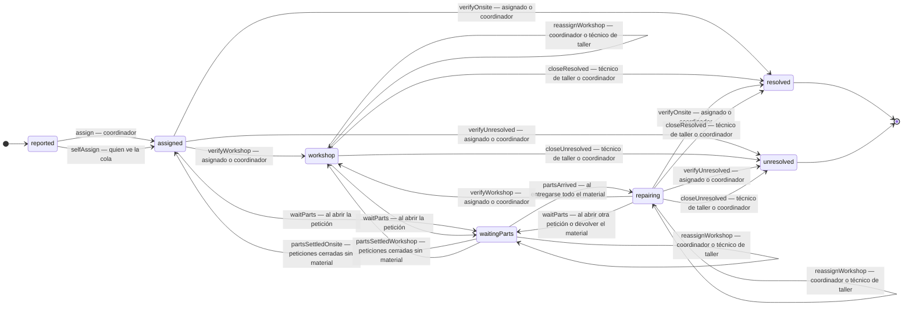
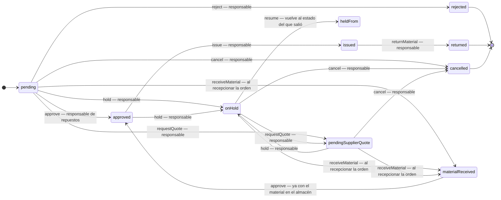
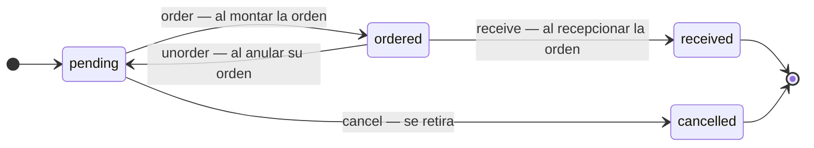
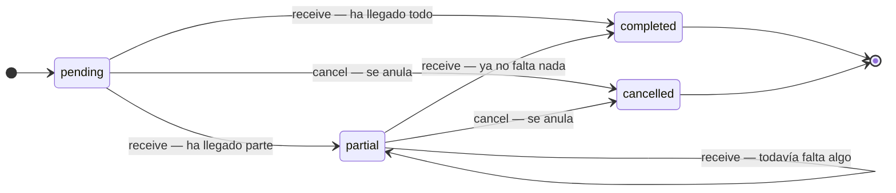

# Las tres máquinas del taller

La incidencia, la petición de repuestos y la compra. Cada una tiene sus estados y
sus pasos escritos **una sola vez**, en su módulo:

| máquina               | la regla                                   | los estados                       |
| --------------------- | ------------------------------------------ | --------------------------------- |
| Incidencia            | [incidentFlow.ts](src/lib/incidentFlow.ts) | `lib/workshop` (`IncidentStatus`) |
| Petición de repuestos | [requestFlow.ts](src/lib/requestFlow.ts)   | `lib/workshop` (`RequestStatus`)  |
| Compra                | [purchaseFlow.ts](src/lib/purchaseFlow.ts) | `lib/purchasing`                  |

Este documento es el dibujo de esas tres —y de la cuarta tabla que lleva dentro la
compra, la de la orden— con **quién puede dar cada paso**. Lo que hay debajo de
las tablas son capacidades (`lib/permissions`), no nombres de rol: el día que un
rol a medida reciba «gestionar incidencias», entrará en el dibujo solo.

El diagrama no se queda atrás por buena voluntad: [maquinas.test.ts](tests/maquinas.test.ts)
lee este fichero y lo compara con las tablas del código. Si aquí falta una
transición, o se cuela una que la máquina no permite, o un paso se llama de otra
forma, la prueba se pone en rojo.

Y la columna «quién» no se queda en promesa: [maquinasPermisos.test.ts](tests/maquinasPermisos.test.ts)
recorre estas tablas paso a paso —cada uno intentado de verdad con la sesión de
cada rol y el caso montado en el estado del que sale— y exige que pase quien
aquí dice que pasa y se quede fuera quien aquí dice que se queda fuera. Un paso
cuyo backend pidiera otra capacidad, o ninguna, se vería aquí.

Y este documento ya no hay que abrirlo para saber dónde está un caso: la
aplicación pinta las mismas cuatro tablas —un bloque por estado, con lo que se
puede hacer desde él y por qué no desde otro sitio— en la pantalla de **«Máquinas
del taller»**. Esa pantalla sale de `lib/machineSheet`, que recorre las tablas del
código en vez de copiarlas, así que sigue a la máquina sola; lo que puede quedarse
atrás es lo de aquí arriba, y quien lo dice es `maquinas.test.ts`.

Lo que **no** está en las máquinas: quién puede dar cada paso. Eso no se escribe
en la tabla de transiciones porque no es un «de dónde a dónde» —el mismo
`assign` se da desde dos estados distintos—, sino una puerta que se comprueba
antes de tocar nada. Las tablas de abajo dicen las dos cosas juntas.

---

## 1. La incidencia

La entrada a esta máquina es el formulario público (`incidents.report`, con el
caso de uso en `lib/incidentIntake`): quien avisa una avería no tiene cuenta ni
permisos, y la ficha nace **notificada** sin dueño.

Cómo se llama cada estado en pantalla: `reported` **Nueva** · `assigned`
**Asignada** · `workshop` **En taller** · `waitingParts` **En espera de
repuestos** · `repairing` **En reparación** · `resolved` **Resuelta** ·
`unresolved` **Sin resolución**.

Dos de esos estados no dicen dónde está el equipo: esperar repuestos o estar en
reparación pasa igual en el banco que en el taller. Eso lo dice su **entrada a
taller abierta** (`workshopAssigneeId`), que es la que decide qué cierre toca —el
trabajo de taller o la verificación en el sitio— y la que la ficha enseña junto al
estado: «En espera de repuestos · taller».

Ningún paso sale de un estado cerrado: lo resuelto y lo que quedó sin resolución
no se reabren desde aquí —volver a por ello es una incidencia nueva, con su propio
rastro—.

Cuatro cosas que no son de estilo:

- **Pedir material abre una espera.** Abrir una petición de repuestos para la
  incidencia la deja en `waitingParts` (`waitParts`): no se trabaja hasta que
  llegue la pieza. Y vale también desde `repairing`, porque devolver el material
  que ya estaba puesto la deja otra vez sin lo que necesita.
- **La entrega cierra la espera.** Cuando ya no queda ninguna petición viva sin
  entregar y alguna llegó a entregarse, la incidencia pasa a `repairing`
  (`partsArrived`). Un rechazo o una cancelación no cuentan como entrega: si se
  cierran todas sin material, la incidencia vuelve a donde estaba —al taller si su
  entrada sigue abierta, a la asignación si no— (`partsSettled*`) en vez de
  esperar algo que ya no va a llegar.
- **El sitio decide el cierre.** `repairing` admite los dos caminos —el cierre de
  taller y la verificación en el sitio— porque el estado no sabe dónde está el
  equipo: el backend exige la entrada a taller abierta para `close*` y su ausencia
  para `verify*`, y la ficha solo enseña el que toca.
- **Cambiar el técnico de taller no mueve el caso.** Vale con el equipo en el
  taller —derivado, esperando material o ya reparándose— y la incidencia se queda
  en el estado en el que está: cambia quién la lleva, no dónde está. Esperar o
  reparar en el sitio no tiene orden que reasignar, y el backend lo rechaza.

### Tabla de pasos — incident

| desde                                 | paso                                                             | hasta                                 | quién                                                                                 |
| ------------------------------------- | ---------------------------------------------------------------- | ------------------------------------- | ------------------------------------------------------------------------------------- |
| `reported` Nueva                      | `assign` Asignar a un técnico                                    | `assigned` Asignada                   | `manageIncidents` el coordinador o el administrador                                   |
| `assigned` Asignada                   | `assign` Asignar a un técnico                                    | `assigned` Asignada                   | `manageIncidents` cambiar de técnico es cosa del coordinador                          |
| `reported` Nueva                      | `selfAssign` Autoasignarme                                       | `assigned` Asignada                   | `viewIncidents` o `manageIncidents` cualquiera que vea la cola se lleva una pendiente |
| `assigned` Asignada                   | `verifyOnsite` Verificar y resolver en el sitio                  | `resolved` Resuelta                   | `manageIncidents` o **el técnico asignado**                                           |
| `assigned` Asignada                   | `verifyWorkshop` Verificar y derivar a taller                    | `workshop` En taller                  | `manageIncidents` o **el técnico asignado**                                           |
| `assigned` Asignada                   | `verifyUnresolved` Verificar y cerrar sin resolución             | `unresolved` Sin resolución           | `manageIncidents` o **el técnico asignado**                                           |
| `assigned` Asignada                   | `waitParts` Quedar a la espera de repuestos                      | `waitingParts` En espera de repuestos | `createRequests` lo abre quien pide el material para el caso                          |
| `workshop` En taller                  | `waitParts` Quedar a la espera de repuestos                      | `waitingParts` En espera de repuestos | `createRequests` lo abre quien pide el material para el caso                          |
| `workshop` En taller                  | `reassignWorkshop` Cambiar el técnico de taller                  | `workshop` En taller                  | `manageIncidents` o **el técnico de la orden de taller**                              |
| `waitingParts` En espera de repuestos | `reassignWorkshop` Cambiar el técnico de taller                  | `waitingParts` En espera de repuestos | `manageIncidents` o **el técnico de la orden de taller**, con el equipo en el taller  |
| `repairing` En reparación             | `reassignWorkshop` Cambiar el técnico de taller                  | `repairing` En reparación             | `manageIncidents` o **el técnico de la orden de taller**, con el equipo en el taller  |
| `workshop` En taller                  | `closeResolved` Cerrar como resuelta                             | `resolved` Resuelta                   | `manageIncidents` o **el técnico asignado o el de taller**                            |
| `workshop` En taller                  | `closeUnresolved` Cerrar sin resolución                          | `unresolved` Sin resolución           | `manageIncidents` o **el técnico asignado o el de taller**                            |
| `waitingParts` En espera de repuestos | `partsArrived` Repuestos entregados                              | `repairing` En reparación             | `decideRequests` lo marca la entrega de la petición, no un botón de la incidencia     |
| `waitingParts` En espera de repuestos | `partsSettledOnsite` Cerrar la espera sin material (en el sitio) | `assigned` Asignada                   | `decideRequests` la petición se rechazó o se canceló sin servir material              |
| `waitingParts` En espera de repuestos | `partsSettledWorkshop` Cerrar la espera sin material (en taller) | `workshop` En taller                  | `decideRequests` la petición se rechazó o se canceló sin servir material              |
| `repairing` En reparación             | `verifyOnsite` Verificar y resolver en el sitio                  | `resolved` Resuelta                   | `manageIncidents` o **el técnico asignado**                                           |
| `repairing` En reparación             | `verifyWorkshop` Verificar y derivar a taller                    | `workshop` En taller                  | `manageIncidents` o **el técnico asignado**                                           |
| `repairing` En reparación             | `verifyUnresolved` Verificar y cerrar sin resolución             | `unresolved` Sin resolución           | `manageIncidents` o **el técnico asignado**                                           |
| `repairing` En reparación             | `waitParts` Quedar a la espera de repuestos                      | `waitingParts` En espera de repuestos | `createRequests` otra petición, o el material devuelto                                |
| `repairing` En reparación             | `closeResolved` Cerrar como resuelta                             | `resolved` Resuelta                   | `manageIncidents` o **el técnico asignado o el de taller**                            |
| `repairing` En reparación             | `closeUnresolved` Cerrar sin resolución                          | `unresolved` Sin resolución           | `manageIncidents` o **el técnico asignado o el de taller**                            |

La segunda puerta no es una capacidad sino una pregunta —«¿la tengo yo?»— y por
eso va en negrita: el técnico asignado verifica y cierra **su** incidencia sin
necesitar permiso de coordinación.

---

## 2. La petición de repuestos

Se entra por `partRequests.create` (`createRequests`, quien pide el material del
taller) y nace **pendiente**. Los pasos que la mueven son de quien decide sobre
repuestos, y la recepción de una compra mueve la última pieza: cuando llega el
material comprado, la petición pasa a **material recibido**, que es desde donde ya
se puede aprobar y entregar.

Cómo se llama cada estado en pantalla: `pending` **Pendiente** · `approved`
**Aprobada** · `onHold` **En espera** · `pendingSupplierQuote` **Presupuesto
pendiente** · `issued` **Entregada** · `materialReceived` **Material recibido** ·
`returned` **Devuelta** · `rejected` **Rechazada** · `cancelled` **Cancelada**.

Dos cosas que no son de estilo:

- **Suspender no es un paso atrás.** `resume` devuelve la petición al estado del
  que salió (`heldFrom`), no siempre a «pendiente»: una que esperaba presupuesto
  no lo olvida al reanudarse, y una ya aprobada —con el material descontado del
  almacén— no vuelve a poder aprobarse, que era la forma de descontarlo dos veces.
- **Solo se compra lo que espera algo.** `canBuyForRequest` deja comprar desde
  `pending`, `onHold` y `pendingSupplierQuote`: de una ya aprobada o entregada no
  se compra nada, y de una rechazada, retirada o devuelta tampoco.

- **El material sale de una en una.** `issue` cierra la petición cuando ya no
  queda nada por entregar, pero las tandas se apuntan por línea
  (`request.lines[].deliveredQuantity`): una petición con parte del material
  entregado sigue en `approved`, que es su estado verdadero —falta material—, y
  `requestDelivery` es quien cuenta qué salió y qué queda. La incidencia no pasa a
  «en reparación» hasta la última unidad, y el seguimiento público solo enseña lo
  que sigue faltando.

### Tabla de pasos — request

| desde                                        | paso                                | hasta                                        | quién                                                                            |
| -------------------------------------------- | ----------------------------------- | -------------------------------------------- | -------------------------------------------------------------------------------- |
| `pending` Pendiente                          | `approve` Aprobar                   | `approved` Aprobada                          | `decideRequests` responsable de repuestos o administrador                        |
| `materialReceived` Material recibido         | `approve` Aprobar                   | `approved` Aprobada                          | `decideRequests` lo comprado ha entrado: ya hay material que apartar             |
| `pending` Pendiente                          | `reject` Rechazar                   | `rejected` Rechazada                         | `decideRequests` responsable de repuestos o administrador                        |
| `pending` Pendiente                          | `hold` Poner en espera              | `onHold` En espera                           | `decideRequests` responsable de repuestos o administrador                        |
| `approved` Aprobada                          | `hold` Poner en espera              | `onHold` En espera                           | `decideRequests` el material sigue apartado mientras tanto                       |
| `pendingSupplierQuote` Presupuesto pendiente | `hold` Poner en espera              | `onHold` En espera                           | `decideRequests` responsable de repuestos o administrador                        |
| `onHold` En espera                           | `resume` Reanudar                   | `heldFrom` vuelve al estado del que salió    | `decideRequests` responsable de repuestos o administrador                        |
| `approved` Aprobada                          | `issue` Entregar material           | `issued` Entregada                           | `decideRequests` responsable de repuestos o administrador; de una en una, lo entregado se apunta por línea y la petición no se cierra hasta la última |
| `issued` Entregada                           | `returnMaterial` Devolver material  | `returned` Devuelta                          | `decideRequests` devuelve el material quien decide sobre repuestos               |
| `pending` Pendiente                          | `cancel` Cancelar petición          | `cancelled` Cancelada                        | `decideRequests` todavía no hay material comprometido                            |
| `onHold` En espera                           | `cancel` Cancelar petición          | `cancelled` Cancelada                        | `decideRequests` una suspensión no compromete material                           |
| `pendingSupplierQuote` Presupuesto pendiente | `cancel` Cancelar petición          | `cancelled` Cancelada                        | `decideRequests` esperar un presupuesto no compromete nada                       |
| `pending` Pendiente                          | `requestQuote` Pedir presupuesto    | `pendingSupplierQuote` Presupuesto pendiente | `decideRequests` responsable de repuestos o administrador                        |
| `onHold` En espera                           | `requestQuote` Pedir presupuesto    | `pendingSupplierQuote` Presupuesto pendiente | `decideRequests` responsable de repuestos o administrador                        |
| `pending` Pendiente                          | `receiveMaterial` Material recibido | `materialReceived` Material recibido         | `managePurchasing` lo marca la recepción de la orden, no un botón de la petición |
| `onHold` En espera                           | `receiveMaterial` Material recibido | `materialReceived` Material recibido         | `managePurchasing` lo marca la recepción de la orden                             |
| `pendingSupplierQuote` Presupuesto pendiente | `receiveMaterial` Material recibido | `materialReceived` Material recibido         | `managePurchasing` lo marca la recepción de la orden                             |

---

## 3. La compra

La compra lleva dos máquinas dentro, encadenadas: la **petición de compra**
(`PC-…`, lo que el almacén no puede cubrir) y la **orden de compra** (`OC-…`, lo
que se manda al proveedor). No las mueve nadie a mano de punta a punta: la
recepción de la orden cierra las peticiones que había dentro, y por eso el paso
`receive` de la petición de compra no tiene botón propio.

Quién entra aquí: las peticiones de compra las aparta el responsable de repuestos
—«Comprar» en una petición de repuestos, `purchasing.requestPurchase`, que pide
`managePurchasing`— y la orden la monta a mano él mismo (`purchasing.createOrder`),
agrupando por proveedor. Ni la petición de compra ni la orden nacen solas: las
abre una persona.

Cómo se llama cada estado: petición de compra — `pending` **Sin tratar** ·
`ordered` **Pedido al proveedor** · `received` **Recibido** · `cancelled`
**Retirada**. Orden — `pending` **Pendiente** · `partial` **Parcial** ·
`completed` **Completada** · `cancelled` **Anulada**.

### La petición de compra

Lo recibido no vuelve: desde `received` y desde `cancelled` no hay paso. Y
`unorder` es la vuelta de `order`, no un botón: lo que le pasa a una petición
cuando se anula la orden en la que iba.

### Tabla de pasos — purchaseRequest

| desde                         | paso                                               | hasta                         | quién                                                              |
| ----------------------------- | -------------------------------------------------- | ----------------------------- | ------------------------------------------------------------------ |
| `pending` Sin tratar          | `order` Entra en una orden y se manda al proveedor | `ordered` Pedido al proveedor | `managePurchasing` lo hace quien monta la orden de compra          |
| `ordered` Pedido al proveedor | `unorder` Vuelve a la cola al anular su orden      | `pending` Sin tratar          | `managePurchasing` es el efecto de anular la orden                 |
| `pending` Sin tratar          | `cancel` Se retira: ya no se compra                | `cancelled` Retirada          | `managePurchasing` solo se retira lo que no está en ninguna orden  |
| `ordered` Pedido al proveedor | `receive` Ha llegado todo lo que se pidió          | `received` Recibido           | `managePurchasing` lo marca la recepción, no la ficha de la compra |

### La orden

El destino de `receive` no es un estado fijo: una orden está completada o parcial
según **lo que haya llegado de cada artículo**, no según el total —recibir 100 de
un artículo y 0 de otro no es haber recibido la mitad—. Lo resuelve
`purchaseOrderStatusAfterReceiving`. Y una orden anulada devuelve sus peticiones a
la cola: es el `unorder` de la máquina de arriba.

### Tabla de pasos — purchaseOrder

| desde               | paso                           | hasta                                                         | quién                                               |
| ------------------- | ------------------------------ | ------------------------------------------------------------- | --------------------------------------------------- |
| `pending` Pendiente | `receive` Recepcionar material | `allReceived` completada o parcial, según lo que haya llegado | `managePurchasing` con el albarán delante           |
| `partial` Parcial   | `receive` Recepcionar material | `allReceived` completada o parcial, según lo que haya llegado | `managePurchasing` con el albarán delante           |
| `pending` Pendiente | `cancel` Anular la orden       | `cancelled` Anulada                                           | `managePurchasing` sus peticiones vuelven a la cola |
| `partial` Parcial   | `cancel` Anular la orden       | `cancelled` Anulada                                           | `managePurchasing` sus peticiones vuelven a la cola |

---

## Lo que las tres comparten

- **La tabla es la única fuente.** Los `if` de cada mutación del backend y los
  botones de la ficha preguntan lo mismo: `canAdvance*` / `next*Status` para el
  servidor y `*StepBlocker` para explicárselo a quien lo intenta. Un paso que no
  se puede dar desde ahí no es un botón escondido —es una frase: «todavía no la ha
  cogido nadie», «primero devuélvela desde “Devolver material”», «ya está
  completada: entró todo lo que se pidió»—.
- **Tipadas contra el esquema.** Una acción nueva sin decidir por dónde pasa, o un
  estado al que nadie llega, no compilan (`satisfies Record<Acción, Paso>`).
- **Los cierres no se reabren.** Lo resuelto, lo rechazado, lo retirado, lo
  recibido y lo completado se quedan como están: volver a por ello es un caso
  nuevo.
- **Quién es una capacidad, con dos excepciones.** Todo lo que se firma se
  comprueba por capacidad (`lib/permissions`); además, en las incidencias manda
  quien tiene el caso («el técnico asignado», «el de la orden de taller» —no es un
  permiso, es la ficha—), y en las peticiones el paso `receiveMaterial` lo da la
  recepción de compras (`managePurchasing`), no el responsable de repuestos.
- **Los tres finales del taller.** El trabajo termina en `resolved` o
  `unresolved` (incidencia), en `approved` → `issued` → `returned` (petición), y
  en `completed` (orden). Lo demás son paréntesis: `onHold` en la petición,
  `partial` en la orden.
