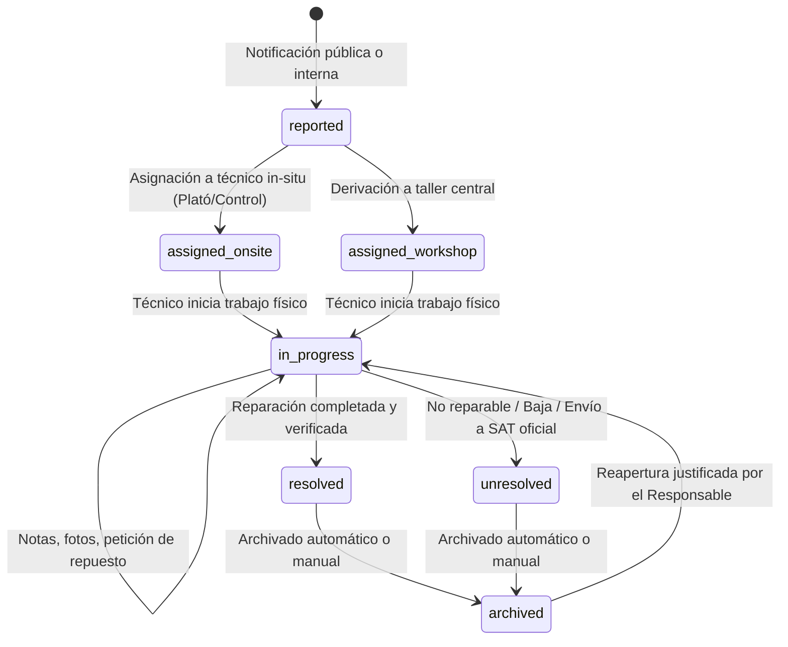
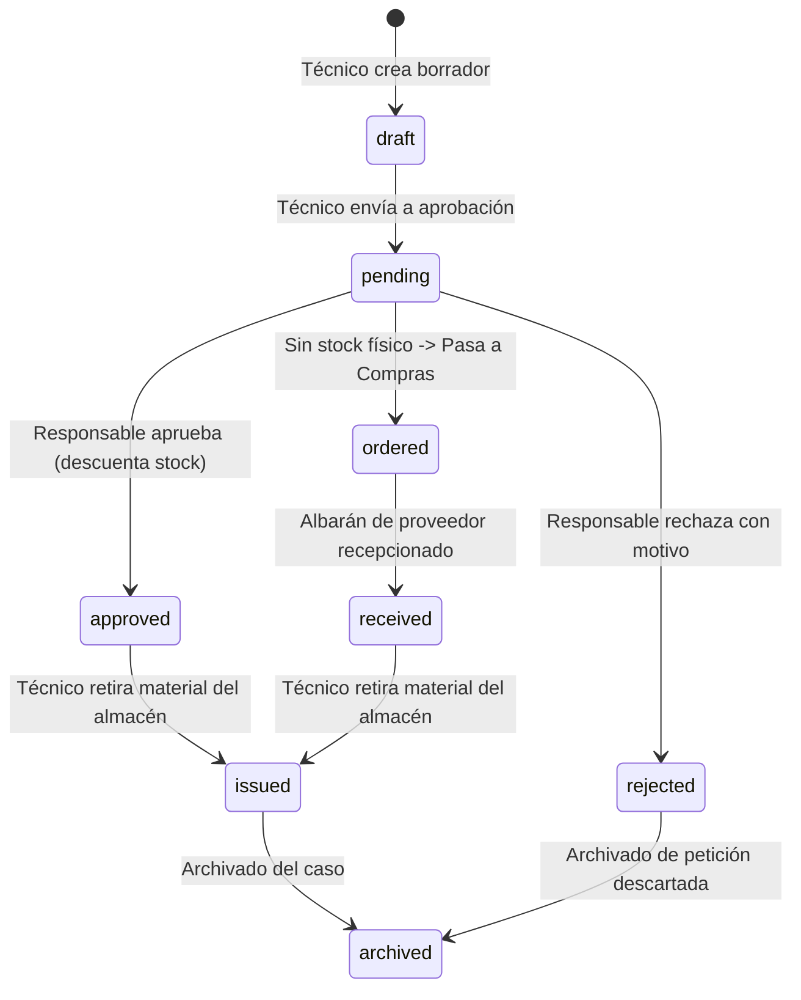

# Manual General de Operación, Mantenimiento y Administración
# Pulso Taller (`GestMant_TS`)
### Sistema de Gestión Integral de Mantenimiento para Entornos Broadcast y Audiovisuales
**Documento Técnico Oficial · Versión 1.1.0**

---

## Control del Documento

| Campo | Detalle |
|---|---|
| **Título del Documento** | Manual General de Operación, Mantenimiento y Administración |
| **Identificador del Sistema** | Pulso Taller (`GestMant_TS`) |
| **Versión del Sistema** | v1.1.0 (Producción) |
| **Fecha de Emisión** | Octubre 2026 |
| **Ámbito de Aplicación** | Centros de Producción Broadcast, Controles Centrales (MCR), Plató y Estudios (PCR), Unidades Móviles y Talleres Electrónicos Centrales |
| **Clasificación de Seguridad** | Uso Interno / Técnico Operativo |
| **Normativa de Referencia** | Vocabulario Ubicuo Industrial (`GLOSARIO.md`), Gobernanza de Código (`AGENTS.md`) |

---

## Índice General

1. [Marco Introductorio y Filosofía del Sistema](#1-marco-introductorio-y-filosofía-del-sistema)
   - 1.1 Misión y Alcance en Entornos de Televisión y Emisión Crítica
   - 1.2 Vocabulario Ubicuo del Taller y Reglas Terminológicas Invariables
   - 1.3 Arquitectura Técnica y Separación de Responsabilidades
2. [Modelo de Identidad, Seguridad y Control de Acceso (RBAC)](#2-modelo-de-identidad-seguridad-y-control-de-acceso-rbac)
   - 2.1 Autenticación y Ciclo de Vida de Sesiones
   - 2.2 Roles Predefinidos del Sistema
   - 2.3 Matriz Exhaustiva de las 18 Capacidades del Taller
   - 2.4 Creación, Clonación y Gestión de Roles Personalizados
   - 2.5 Registro de Auditoría de Seguridad Inmutable
3. [Gestión y Ciclo de Vida de Incidencias](#3-gestión-y-ciclo-de-vida-de-incidencias)
   - 3.1 Máquina de Estados Finita de Incidencias
   - 3.2 Canal de Notificación Pública (Intake Ágil sin Credenciales)
   - 3.3 Alta de Equipos en Caliente durante el Reporte
   - 3.4 Triaje, Priorización y Asignación (In-situ vs Taller Central)
   - 3.5 El Cuaderno Técnico de Intervención y Editor Enriquecido
   - 3.6 Trazabilidad de Notas, Historial de Revisiones y Restauración
   - 3.7 Resolución, Causas Raíz y Generación del Parte de Trabajo en PDF
4. [Gestión del Almacén, Repuestos y Control de Existencias](#4-gestión-del-almacén-repuestos-y-control-de-existencias)
   - 4.1 Ficha Técnica del Repuesto y Normalización de Referencias (P/N)
   - 4.2 Sistema Físico de Ubicaciones en Almacén
   - 4.3 Control de Existencias, Stock Mínimo y Alertas de Rotura
   - 4.4 Matriz de Compatibilidad Repuesto-Equipo
5. [Circuito de Peticiones de Repuesto y Aprovisionamiento](#5-circuito-de-peticiones-de-repuesto-y-aprovisionamiento)
   - 5.1 Máquina de Estados de Peticiones de Repuesto
   - 5.2 Emisión de Peticiones por el Técnico
   - 5.3 Proceso de Aprobación, Deducción Automática y Rechazo Motivado
   - 5.4 Circuito de Compras: Consolidación por Proveedor
   - 5.5 Recepción de Albaranes y Actualización Automática de Stock
   - 5.6 Entrega Física de Material y Cierre de la Petición
6. [Inventario de Equipos y Mantenimiento Preventivo](#6-inventario-de-equipos-y-mantenimiento-preventivo)
   - 6.1 Ficha Maestra del Equipo y Trazabilidad Serializada
   - 6.2 Normalización de Modelos de Equipos y Fabricantes
   - 6.3 Registro Histórico de Intervenciones Correctivas
   - 6.4 Mantenimiento Preventivo: Planes Periódicos y Alertas de Vencimiento
   - 6.5 Exportación de la Ficha Técnica Integral del Equipo en PDF
7. [Biblioteca de Manuales de Servicio y Documentación Técnica](#7-biblioteca-de-manuales-de-servicio-y-documentación-técnica)
   - 7.1 Gestión de Manuales de Servicio y Esquemáticos Electrónicos
   - 7.2 Vinculación Cruzada entre Manuales y Equipos
   - 7.3 Notas Técnicas Colaborativas del Taller
8. [Administración Avanzada, Ajustes Corporativos y Auditoría](#8-administración-avanzada-ajustes-corporativos-y-auditoría)
   - 8.1 Membrete Corporativo, Datos Fiscales y Logotipo Oficial
   - 8.2 Monitor de "Trabajo sin Traza" y Prevención de Desviaciones
   - 8.3 Motor de Informes Semanales Automatizados
   - 8.4 Mantenimiento del Almacenamiento, Archivos Huérfanos y Papelera
   - 8.5 Políticas de Archivado Automático de Casos Antiguos
9. [Comunicaciones Internas, Avisos y Búsqueda Global](#9-comunicaciones-internas-avisos-y-búsqueda-global)
   - 9.1 Mensajería Directa entre Miembros del Taller
   - 9.2 Centro de Notificaciones Operativas en Tiempo Real
   - 9.3 Motor de Búsqueda Global Asistida
10. [Infraestructura, Respaldo y Continuidad Operativa](#10-infraestructura-respaldo-y-continuidad-operativa)
    - 10.1 Arquitectura del Servidor Local y Despliegue en Synology NAS
    - 10.2 Procedimientos Automatizados de Backup y Retención
    - 10.3 Plan de Recuperación ante Desastres (Disaster Recovery)
11. [Guía de Resolución de Incidencias Operativas (Troubleshooting)](#11-guía-de-resolución-de-incidencias-operativas-troubleshooting)
12. [Anexos Técnicos y Tablas Normativas](#12-anexos-técnicos-y-tablas-normativas)

---

## 1. Marco Introductorio y Filosofía del Sistema

### 1.1 Misión y Alcance en Entornos de Televisión y Emisión Crítica
En una cadena de televisión, una plataforma de distribución de streaming o una productora audiovisual, el tiempo de inactividad técnica de una señal de vídeo o audio en directo se traduce en pérdidas económicas críticas, degradación reputacional y penalizaciones regulatorias.

**Pulso Taller (`GestMant_TS`)** nace con la misión de erradicar la improvisación en el mantenimiento broadcast. Proporciona una plataforma única e integrada donde conviven:
1. La velocidad de notificación inmediata que exige un operador de plató durante un directo.
2. La profundidad analítica y trazabilidad técnica que necesita un ingeniero de taller al diagnosticar un fallo de microelectrónica.
3. El control riguroso de existencias de repuestos de alto valor y componentes descatalogados.
4. El respaldo legal y corporativo de partes de trabajo oficiales e informes consolidados de fiabilidad técnica.

### 1.2 Vocabulario Ubicuo del Taller y Reglas Terminológicas Invariables
La precisión en el lenguaje es una barrera fundamental contra los errores operativos. En Pulso Taller rige de manera obligatoria el **Vocabulario Ubicuo** definido en `GLOSARIO.md`. Toda persona, manual o proceso debe respetar las siguientes definiciones:

| Concepto Oficial | Términos Excluidos / Prohibidos | Significado y Contexto de Uso |
|---|---|---|
| **Incidencia** | *Ticket*, *avería*, *fallo*, *problema*, *ticket de soporte* | Suceso o anomalía técnica identificada en un equipo o sistema audiovisual. Una incidencia abre un expediente formal que registrará todas las actuaciones hasta su cierre verificado. |
| **Equipo** | *Máquina*, *aparato*, *dispositivo*, *caja* | Unidad física individual catalogada en el inventario del taller (cámara de estudio, matriz de conmutación, CCU, mezclador, servidor de repeticiones, monitor de forma de onda, etc.). |
| **Petición de repuesto** | *Solicitud de material*, *pedido interno*, *requisición* | Requerimiento oficial tramitado por un técnico solicitando piezas o consumibles del almacén para subsanar una incidencia o realizar un mantenimiento. |
| **Parte de trabajo** | *Informe*, *orden de servicio*, *albarán de trabajo* | Documento formal numerado que recoge la justificación, intervenciones, horas dedicadas, piezas utilizadas y firmas que avalan el cierre técnico de una incidencia. |
| **Técnico** | *Operario*, *mecánico*, *usuario técnico*, *currito* | Profesional especializado en el diagnóstico, reparación, calibración y mantenimiento del equipamiento broadcast. |

### 1.3 Arquitectura Técnica y Separación de Responsabilidades
Pulso Taller está construido bajo el estándar arquitectónico de **Clean Architecture** (Arquitectura Limpia) complementado por el patrón reactivo sobre WebSockets de **Convex**:

```
+---------------------------------------------------------------------------------------+
|                               CAPA DE PRESENTACIÓN (UI)                               |
|   React 19 · TypeScript · Tailwind CSS v4 · Radix UI · Lucide Icons · TipTap RichText |
|   Vistas Modularizadas: Incidencias, Peticiones, Compras, Repuestos, Equipos, Manuales|
+-------------------------------------------+-------------------------------------------+
                                            │ Reactividad en Tiempo Real
                                            ▼
+---------------------------------------------------------------------------------------+
|                       CAPA DE INFRAESTRUCTURA DE DATOS (BACKEND)                      |
|   Convex Serverless · Base de Datos Documental Reactiva · Autenticación RBAC          |
|   Validación de identidad, permisos en mutaciones y persistencia atómica              |
+-------------------------------------------+-------------------------------------------+
                                            │ Consulta obligatoria de reglas
                                            ▼
+---------------------------------------------------------------------------------------+
|                         NÚCLEO DE DOMINIO PURO (CLEAN CORE)                           |
|   `src/lib/*`: incidentFlow.ts, requestFlow.ts, purchaseFlow.ts, reportPdf, richDoc   |
|   Lógica de negocio determinista, 0 dependencias de React o Convex, 100% testeable    |
+---------------------------------------------------------------------------------------+
```

Esta separación garantiza que las reglas de negocio (ej. qué transiciones de estado son válidas o qué condiciones exige un cierre de incidencia) vivan en un núcleo puro inmutable ante cambios de interfaz o de servidor.

---

## 2. Modelo de Identidad, Seguridad y Control de Acceso (RBAC)

### 2.1 Autenticación y Ciclo de Vida de Sesiones
La autenticación de Pulso Taller se gestiona mediante `@convex-dev/auth`, implementando protocolos seguros de derivación criptográfica de contraseñas (`scrypt`), emisión de tokens de sesión con clave privada RSA/Ed25519 y revocación instantánea:
- **Primer arranque:** Si el taller no cuenta con usuarios dados de alta, el sistema promueve automáticamente la primera cuenta registrada con el correo maestro configurado (`admin@taller.es` o `INITIAL_ADMIN_EMAIL`) al rol de **Administrador**.
- **Cuentas de técnico:** Son dadas de alta exclusivamente por el Administrador desde el panel de gestión de personal. No existe auto-registro abierto para roles de gestión.
- **Revocación de credenciales:** El Administrador puede desactivar el acceso de cualquier cuenta de inmediato (invalidando todas sus sesiones activas en segundos).

### 2.2 Roles Predefinidos del Sistema
El sistema provee de base cuatro roles canónicos:

1. **`guest` (Invitado):** Sesión anónima de consulta. Puede acceder a la Landing page, reportar incidencias públicas y consultar el estado de una incidencia mediante su código único de seguimiento. No tiene acceso a módulos internos, catálogo ni inventario.
2. **`technician` (Técnico):** Profesional de guardia o taller. Accede a su cola de incidencias asignadas, escribe en el cuaderno técnico, sube documentación fotográfica, solicita repuestos al almacén y consulta manuales de servicio.
3. **`manager` (Responsable de Repuestos / Coordinador de Taller):** Responsable de la gestión del taller. Asigna incidencias a los técnicos, aprueba o rechaza peticiones de repuesto, emite órdenes de compra, recepciona albaranes, administra el inventario de equipos y emite partes de trabajo oficiales en PDF.
4. **`admin` (Administrador):** Máxima autoridad técnica. Posee todas las facultades del Responsable y gestiona además las cuentas de usuario, la matriz de permisos de roles, los ajustes fiscales del taller, las alertas de "trabajo sin traza" y los registros de auditoría de seguridad.

### 2.3 Matriz Exhaustiva de las 18 Capacidades del Taller
El sistema desacopla los roles de las acciones mediante una matriz de 18 capacidades técnicas granulares:

```
[Capacidades del Sistema Pulso Taller]
├── Módulo de Incidencias
│   ├── viewIncidents: Ver el listado y la cola de incidencias.
│   └── manageIncidents: Asignar a técnicos, derivar a taller y autorizar cierres.
├── Módulo de Peticiones de Repuesto
│   ├── viewRequests: Ver la tabla de peticiones y su estado.
│   ├── createRequests: Solicitar repuestos para una intervención técnica.
│   ├── lookupCatalog: Consultar existencias de repuestos al crear una petición.
│   └── decideRequests: Aprobar o rechazar peticiones y marcar material como entregado.
├── Módulo de Compras
│   ├── viewPurchasing: Ver órdenes de compra y artículos pendientes de proveedor.
│   └── managePurchasing: Crear pedidos oficiales y recepcionar albaranes de entrega.
├── Módulo de Repuestos (Almacén)
│   ├── viewInventory: Consultar el catálogo general y ubicaciones de almacén.
│   └── manageInventory: Altas, bajas, ajustes de stock y edición de números de parte.
├── Módulo de Equipos (Inventario)
│   ├── viewEquipment: Consultar el parque de equipos audiovisuales y sus fichas.
│   ├── manageEquipment: Altas de equipos, números de serie y planes preventivos.
│   └── lookupEquipment: Seleccionar equipos del catálogo al reportar o verificar.
├── Módulo de Manuales Técnicos
│   ├── viewManuals: Visualizar y descargar manuales de servicio y esquemáticos.
│   └── manageManuals: Subir nuevos archivos PDF y definir su clasificación técnica.
├── Módulo de Comunicación
│   └── sendMessages: Enviar y responder mensajes internos entre miembros del taller.
└── Módulo de Administración (Capacidades Bloqueadas solo para Administrador)
    ├── manageUsers: Alta, baja, reactivación y cambio de rol de usuarios.
    ├── configurePermissions: Modificar la matriz de capacidades de cualquier rol.
    └── viewAudit: Acceder a los registros de auditoría de documentos y expedientes.
```

### 2.4 Creación, Clonación y Gestión de Roles Personalizados
Para adaptarse a estructuras organizativas de cualquier medio de comunicación (cadenas autonómicas, televisiones nacionales o productoras de eventos), el Administrador puede crear roles a medida desde la vista **«Roles y permisos»**:
1. Pulsa en **«Crear rol personalizado»**.
2. Asigna un nombre descriptivo (ej. *«Coordinador de Plató»*, *«Auxiliar de Almacén»*, *«Jefe de Emisiones»*). El sistema genera automáticamente su slug identificativo.
3. Elige si deseas iniciar con una plantilla vacía o clonar los permisos de un rol existente.
4. En la matriz, activa o desactiva las casillas correspondientes a las capacidades deseadas.
5. Pulsa **«Guardar cambios»**. Los miembros a los que se asigne este nuevo rol verán actualizado su entorno de trabajo de manera inmediata.

### 2.5 Registro de Auditoría de Seguridad Inmutable
La tabla `securityAuditLog` almacena de forma inmutable cada acción sensible realizada en el sistema:
- Inicio y cierre de sesión de usuarios, incluyendo dirección IP y navegador.
- Cambios de rol o privilegios de usuario.
- Modificaciones en la configuración fiscal del taller o membrete de documentos.
- Descarga, adición o retirada de documentos en los expedientes de incidencias.
> **Guardrail de Seguridad:** La tabla de auditoría jamás puede ser purgada ni vaciada mediante herramientas de reseteo del taller (`workshopReset.ts`). Su inmutabilidad está protegida por tests automáticos de seguridad en `tests/seguridad.test.ts`.

---

## 3. Gestión y Ciclo de Vida de Incidencias

### 3.1 Máquina de Estados Finita de Incidencias
Toda incidencia sigue un ciclo de vida estrictamente gobernado por la máquina de estados ubicada en `src/lib/incidentFlow.ts`. Queda prohibida cualquier transición manual arbitraria:



| Estado | Clave Técnica | Significado Operativo | Acción Siguiente Típica |
|---|---|---|---|
| **Notificada** | `reported` | La incidencia ha sido registrada pero aún no ha sido triada por coordinación. | Evaluar y asignar a técnico in-situ o taller. |
| **Asignada in-situ** | `assigned_onsite` | Asignada a un técnico para intervención directa en el puesto de trabajo. | Técnico pulsa «Iniciar intervención». |
| **Derivada a taller** | `assigned_workshop` | El equipo debe ser desinstalado y trasladado al taller central. | Recepción física e inicio de diagnóstico. |
| **En progreso** | `in_progress` | El técnico está interviniendo activamente en el diagnóstico o reparación. | Añadir notas, pedir repuestos o resolver. |
| **Resuelta** | `resolved` | La reparación ha concluido con éxito y el equipo es plenamente operativo. | Emisión del Parte de Trabajo en PDF. |
| **No resuelta** | `unresolved` | El equipo no pudo ser reparado (daño irreparable, obsolescencia o envío a SAT externo). | Justificación de baja o envío externo. |
| **Archivada** | `archived` | Expediente cerrado formalmente tras cumplir el periodo de retención activa. | Consulta en módulo de archivo histórico. |

### 3.2 Canal de Notificación Pública (Intake Ágil sin Credenciales)
Durante una emisión en directo, cualquier persona de producción debe poder notificar un problema técnico en menos de 30 segundos sin lidiar con inicios de sesión bloqueados o contraseñas olvidadas:
- **Acceso:** Desde la pantalla pública inicial o mediante enlace directo `/reportar`.
- **Campos obligatorios:**
  1. *Título descriptivo:* Síntoma evidente de la anomalía (ej. *«CCU de Cámara 3 pierde retorno de teleprompter»*).
  2. *Ubicación del suceso:* Plató, control de realización, rack de servidores o control central.
  3. *Nivel de criticidad:*
     - **Urgente:** Afecta a la señal de directo o grabación inmediata sin alternativa.
     - **Alta:** Compromete un sistema principal con redundancia operativa activa.
     - **Normal:** Fallo secundario, estético o degradación de calidad no bloqueante.
  4. *Descripción detallada:* Datos de contexto, comportamiento y cables sustituidos en primera instancia.
- **Adjuntos fotográficos:** Posibilidad de subir fotografías del panel de conexiones, displays de error del equipo o capturas de vídeo.
- **Identificador de seguimiento:** Al confirmar el envío, la plataforma genera un código alfanumérico único (ej. `INC-2026-0042`) que el operador puede guardar para consultar la evolución del caso en cualquier momento.

### 3.3 Alta de Equipos en Caliente durante el Reporte
Una de las mayores fricciones en talleres reales ocurre cuando el operador intenta notificar un problema en un equipo recién llegado que aún no ha sido inventariado por almacén:
- En el formulario de notificación pública, junto al selector de equipos, existe el botón **«Dar de alta equipo»**.
- Al pulsar este botón, se abre un subformulario emergente que permite registrar:
  - Marca y Modelo del equipo.
  - Número de serie (S/N) y código de barras si lo tuviera.
  - Ubicación física actual.
- El sistema crea una pre-ficha de equipo en el catálogo y la asocia de forma inmediata a la nueva incidencia, evitando la pérdida de trazabilidad desde el primer segundo de vida útil del equipo.

### 3.4 Triaje, Priorización y Asignación (In-situ vs Taller Central)
El Responsable de Repuestos o Coordinador de Turno monitoriza en tiempo real la cola de incidencias notificadas:
1. **Evaluación de la criticidad:** Si la incidencia compromete la escaleta del programa, se le otorga prioridad urgente y se emite una notificación sonora/visual en el panel de control.
2. **Determinación de la tipología de trabajo:**
   - *In-situ:* Problemas de cableado, configuración de menú, cambio de ópticas en plató o sustitución de tarjetas modulares en caliente. Se asigna a un técnico de guardia en plató.
   - *Taller Central:* Fallos de fuente de alimentación conmutada, cortocircuitos en placas base, sustitución de componentes BGA/SMD o calibración óptica. El coordinador instruye el traslado físico del equipo al banco de trabajo del taller.
3. **Asignación formal:** El coordinador selecciona al técnico especialista disponible. A partir de ese instante, la incidencia entra en la bandeja de trabajo personalizada de dicho técnico.

### 3.5 El Cuaderno Técnico de Intervención y Editor Enriquecido
El corazón de la labor diagnóstica es el **Cuaderno Técnico**. A diferencia de los sistemas tradicionales con campos de texto plano limitados, Pulso Taller integra un editor de texto enriquecido profesional basado en **TipTap**:
- **Formateo estructurado:** Encabezados de diagnóstico, listas de comprobación de pasos, textos destacados en negrita o código monoespaciado para comandos o valores de registro.
- **Inserción directa de imágenes:** El técnico puede pegar capturas desde el portapapeles o subir fotografías de placas de circuito, pantallas de osciloscopio, trazas de analizador de espectro o termografías de componentes sobrecalentados.
- **Registro cronológico de intervenciones:** Cada aportación al cuaderno queda registrada con la firma del técnico y la marca de tiempo exacta de la intervención.

### 3.6 Trazabilidad de Notas, Historial de Revisiones y Restauración
Para evitar la alteración maliciosa o accidental de los expedientes técnicos:
- **Inmutabilidad del histórico:** Si un técnico edita una nota previa para corregir un dato de medición, el sistema no sobreescribe el texto original, sino que archiva una versión histórica con su sello temporal.
- **Visualizador de revisiones:** Cualquier coordinador puede consultar el historial completo de cambios de cada nota del cuaderno técnico.
- **Botón de Deshacer (Undo):** Tras cualquier modificación o retirada accidental de una anotación, el técnico dispone de una notificación interactiva para revertir la acción de inmediato sin intervención del administrador.

### 3.7 Resolución, Causas Raíz y Generación del Parte de Trabajo en PDF
Cuando el equipo ha sido reparado, calibrado y probado satisfactoriamente:
1. El técnico cumplimenta el informe final de intervención en el cuaderno técnico, especificando la causa raíz del problema (ej. *«Fallo por degradación térmica de condensadores C12 y C14 en etapa reguladora DC-DC»*).
2. El Responsable valida la actuación y pulsa en **«Resolver incidencia»**.
3. **Generación automática del Parte de Trabajo oficial en PDF:**
   - Pulso Taller compila al vuelo un documento PDF normalizado bajo estándares industriales.
   - El documento incluye de forma automática:
     - Cabecera oficial con membrete corporativo, logotipo, datos fiscales y fecha de emisión.
     - Identificador alfanumérico y código de barras del caso.
     - Datos de trazabilidad temporal: fecha/hora de reporte, inicio de trabajo y resolución (con cálculo automático de MTTR - Mean Time to Repair).
     - Ficha técnica del equipo intervenido: modelo, número de serie, versión de firmware y ubicación.
     - Transcripción completa del cuaderno técnico con sus fotografías incrustadas en alta definición.
     - Relación detallada de piezas y repuestos consumidos con sus referencias (P/N) y números de lote.
     - Espacio formal de firma digital o manuscrita para el técnico y el responsable.
   - Este archivo PDF es inalterable y constituye el justificante oficial exigible en auditorías de calidad o peritajes técnicos.

---

## 4. Gestión del Almacén, Repuestos y Control de Existencias

### 4.1 Ficha Técnica del Repuesto y Normalización de Referencias (P/N)
El catálogo de repuestos es el registro central de todos los componentes electrónicos, módulos y consumibles custodiados en el taller:
- **Denominación técnica oficial:** Nombre inequívoco del componente (ej. *«Transmisor Óptico SFP+ 10Gbps 1310nm Monomodo»* o *«Ventilador 40x40x20mm 12VDC Rodamiento Levitation»*).
- **Número de parte del fabricante (P/N):** Código alfanumérico exacto del fabricante original (ej. *AFBR-709SMZ*, *PSD1204PQBX-A*).
- **Fabricante / Marca:** Identificación de la marca original (Sony, Grass Valley, Panasonic, Texas Instruments, Murata, etc.).
- **Categoría y encapsulado:** Clasificación técnica (Semiconductores, Pasivos, Conectores, Óptica, Módulos de Potencia, Mecánica).

### 4.2 Sistema Físico de Ubicaciones en Almacén
Para erradicar la búsqueda infructuosa de componentes durante emergencias de directo, cada ficha de repuesto cuenta con su localización física estandarizada:
- **Formato de nomenclatura:** `[Área / Módulo] · [Pasillo / Estantería] · [Cajón / Bandeja]`.
- **Ejemplo real:** `Almacén Central · Módulo Electrónica · Cajonera B3 · Gaveta 12`.
- El técnico o responsable visualiza la ubicación directamente al consultar la pieza en el buscador o al recibir una aprobación de material.

### 4.3 Control de Existencias, Stock Mínimo y Alertas de Rotura
Pulso Taller gestiona tres valores fundamentales de inventario por cada repuesto:
1. **Stock actual (existencias reales):** Unidades físicas disponibles inmediatamente en el cajón de almacén.
2. **Stock mínimo:** Umbral crítico por debajo del cual el almacén corre riesgo de desabastecimiento. Al alcanzar este valor, la plataforma activa de forma automática una advertencia visual amarilla en el panel y sugiere la apertura de una orden de compra.
3. **Stock óptimo:** Cantidad recomendada para pedidos periódicos que amortice costes de transporte y garantice la operatividad de turnos completos.

### 4.4 Matriz de Compatibilidad Repuesto-Equipo
Un error crítico en talleres broadcast es montar una variante incompatible de un componente (ej. colocar una fuente de 12V con rizado no filtrado en un procesador de vídeo de bajo ruido):
- Cada ficha de repuesto permite vincular de forma bidireccional los equipos del inventario con los que es compatible.
- Al consultar un equipo en el inventario, el técnico puede ver instantáneamente qué repuestos tiene el almacén disponibles para ese modelo específico.
- Al tramitar una petición de repuesto para una incidencia, el buscador filtra por defecto las referencias compatibles con el equipo averiado.

---

## 5. Circuito de Peticiones de Repuesto y Aprovisionamiento

### 5.1 Máquina de Estados de Peticiones de Repuesto
Gobernada por `src/lib/requestFlow.ts`, la máquina de estados de peticiones asegura que ninguna pieza salga del almacén sin control de stock:



### 5.2 Emisión de Peticiones por el Técnico
Cuando durante una intervención el técnico determina que debe reemplazar un componente:
1. Desde la ficha de la incidencia o el menú **«Peticiones»**, pulsa **«Nueva petición de repuesto»**.
2. **Selección del material:** Busca el repuesto por nombre o P/N. La plataforma le indica en pantalla si hay existencias disponibles en almacén.
3. **Cantidad solicitada:** Número exacto de unidades requeridas.
4. **Justificación diagnóstica:** Explicación técnica obligatoria de por qué se requiere la sustitución (ej. *«Rotura física del conector BNC tras golpe en unidad móvil»*).
5. Pulsa en **«Enviar petición»**.

### 5.3 Proceso de Aprobación, Deducción Automática y Rechazo Motivado
El Responsable de Repuestos recibe una notificación inmediata en su panel:
- **Aprobación estándar:** Si hay stock, pulsa **«Aprobar»**. En ese milisegundo, el motor reactivo de Convex descuenta las unidades solicitadas del stock disponible del almacén, evitando dobles asignaciones por parte de otros técnicos.
- **Rechazo motivado:** Si el componente solicitado no es el adecuado o existe una alternativa reparable, el responsable pulsa **«Rechazar»** e introduce obligatoriamente una nota explicativa que se notificará al técnico.

### 5.4 Circuito de Compras: Consolidación por Proveedor
Si no existen existencias suficientes en almacén para satisfacer la necesidad de una incidencia:
1. La petición pasa al estado `ordered` (Pendiente de compra).
2. En el módulo **«Compras»**, las necesidades de piezas se agrupan automáticamente según el proveedor habitual registrado (ej. *RS Components, Farnell, Digikey, Sony Broadcast, Riedel*).
3. El responsable revisa las líneas consolidadas y genera una **Orden de Compra oficial** numerada (ej. `OC-2026-015`).
4. La orden se envía al proveedor mediante el canal administrativo habitual.

### 5.5 Recepción de Albaranes y Actualización Automática de Stock
Cuando el transportista entrega las piezas en las instalaciones del taller:
1. El responsable abre la Orden de Compra correspondiente en Pulso Taller y pulsa en **«Recepcionar albarán»**.
2. Introduce el número de albarán del proveedor y la fecha de entrega.
3. Marca las unidades realmente recibidas (el sistema soporta **recepciones parciales** si el proveedor no envió la totalidad del pedido).
4. Al confirmar la recepción:
   - El stock del almacén se incrementa de forma automática en el catálogo.
   - Las peticiones de repuesto que estaban esperando esa pieza cambian automáticamente a estado `received` (Recibido).
   - Los técnicos autores de las peticiones reciben una notificación emergente avisándoles de que el material ya está disponible en almacén para su recogida.

### 5.6 Entrega Física de Material y Cierre de la Petición
1. El técnico acude físicamente al almacén a retirar los componentes aprobados.
2. El responsable entrega las piezas y pulsa **«Marcar como entregado»** (`issued`).
3. La petición queda sellada con el registro exacto de quién la autorizó y quién la retiró, incorporándose definitivamente al expediente de la incidencia para su cómputo de costes y trazabilidad.

---

## 6. Inventario de Equipos y Mantenimiento Preventivo

### 6.1 Ficha Maestra del Equipo y Trazabilidad Serializada
Cada equipo audiovisual censado en Pulso Taller dispone de una ficha maestra única con los siguientes atributos normalizados:
- **Código de inventario interno:** Identificador único de taller (ej. `EQ-CAM-004`).
- **Marca y Modelo:** Fabricante y referencia comercial exacta.
- **Número de Serie (S/N):** Clave inequívoca para auditorías y garantías de fabricante.
- **Versión de Firmware instalada:** Esencial para detectar anomalías de software en equipos de red y vídeo sobre IP (SMPTE ST 2110).
- **Ubicación operativa habitual:** Plató 1, Control Central, Unidad Móvil 1, Taller de Electrónica, Reserva de Almacén.
- **Fechas de compra y garantía:** Indicador visual de si el equipo está cubierto por garantía oficial de fabricante o si los costes deben ser asumidos íntegramente por el taller.

### 6.2 Normalización de Modelos de Equipos y Fabricantes
A través del módulo `equipmentModels.ts`, el sistema normaliza la nomenclatura de los modelos de equipos para evitar duplicidades habituales causadas por diferentes formas de escribir un modelo (ej. *«Sony HDC4300»*, *«HDC-4300»*, *«Sony 4300»*).
- Los modelos se catalogan con su fabricante y categoría técnica.
- Al dar de alta un equipo nuevo, el selector ofrece autocompletado inteligente asistido.

### 6.3 Registro Histórico de Intervenciones Correctivas
Desde la ficha del equipo, cualquier técnico o coordinador puede revisar la vida completa del aparato:
- Lista cronológica de todas las incidencias sufridas desde su fecha de alta.
- Número acumulado de horas de avería.
- Relación de componentes electrónicos reemplazados a lo largo de su historia.
- Esta información es vital para identificar **equipos recurrentes** o unidades que han alcanzado el final de su vida útil rentable.

### 6.4 Mantenimiento Preventivo: Planes Periódicos y Alertas de Vencimiento
El mantenimiento correctivo repara lo que ya ha fallado; el preventivo evita que el fallo ocurra en plena retransmisión:
- **Planes periódicos de revisión:** Se configuran periodicidades recomendadas por fabricante (mensual, trimestral, semestral, anual).
- **Protocolos estándar por tipo de equipo:**
  - *Cámaras de estudio:* Limpieza de bloque óptico y prismas, soplado de conductos de refrigeración, comprobación de conectores LEMO SMPTE híbridos y balance de negros.
  - *Servidores de vídeo:* Sustitución preventiva de ventiladores axiales, verificación de matrices RAID de discos, test de memoria ECC y limpieza de filtros de aire frontales.
  - *Fuentes de alimentación conmutadas:* Medición de rizado de continua con osciloscopio y comprobación de ESR en condensadores electrolíticos.
- **Semáforo de vencimiento:**
  - `Verde (Al día):` Revisión vigente dentro de plazo.
  - `Ámbar (Próxima):` Quedan menos de 15 días para la fecha de revisión programada.
  - `Rojo (Vencida):` La fecha de revisión ha caducado sin haberse registrado la intervención.

### 6.5 Exportación de la Ficha Técnica Integral del Equipo en PDF
En cualquier momento se puede pulsar el botón **«Exportar ficha técnica»** desde la vista de equipo. El sistema genera un PDF corporativo con las especificaciones técnicas completas del aparato, su historial acumulado de intervenciones, las piezas sustituidas y el estado actual de sus revisiones preventivas.

---

## 7. Biblioteca de Manuales de Servicio y Documentación Técnica

### 7.1 Gestión de Manuales de Servicio y Esquemáticos Electrónicos
En el ámbito broadcast, reparar sin el manual de servicio oficial (Service Manual) con los esquemas de circuito (Schematics) y el despiece mecánico (Exploded View) es inviable:
- El módulo **«Manuales»** centraliza todos los documentos técnicos oficiales en formato PDF.
- Los archivos se almacenan en el sistema de almacenamiento persistente de la plataforma y se sirven mediante visor embebido sin depender de visores externos.
- Búsqueda instantánea por modelo de equipo, fabricante o palabra clave del manual.

### 7.2 Vinculación Cruzada entre Manuales y Equipos
Un manual subido a la plataforma puede asociarse directamente a uno o varios modelos de equipo:
- Al abrir la ficha de una incidencia sobre un mezclador de audio *Yamaha CL5*, el técnico encuentra a un solo clic el enlace directo al manual de servicio del equipo sin tener que abandonar su flujo de trabajo ni buscar en carpetas compartidas de red desordenadas.

### 7.3 Notas Técnicas Colaborativas del Taller
Los manuales oficiales del fabricante a menudo omiten peculiaridades descubiertas por los propios técnicos tras años de uso del equipo:
- Pulso Taller permite añadir **Notas Técnicas del Taller** asociadas a cada manual.
- *Ejemplo de uso:* Si un técnico descubre que un conmutador de vídeo tiende a bloquearse cuando la temperatura del rack supera los 28 °C debido a un termistor mal calibrado de fábrica, puede documentarlo en una nota en el manual.
- Todo el turno técnico tendrá acceso inmediato a esa sabiduría operativa acumulada.

---

## 8. Administración Avanzada, Ajustes Corporativos y Auditoría

### 8.1 Membrete Corporativo, Datos Fiscales y Logotipo Oficial
En la pestaña **«Ajustes del taller»**, el Administrador configura los datos institucionales que gobernarán todas las exportaciones oficiales:
- Nombre del Centro de Producción o Empresa Audiovisual.
- Razón Social, CIF/NIF y Dirección física del servicio técnico.
- Teléfono de contacto y correo electrónico de emergencias.
- Logotipo oficial corporativo (subida directa de archivo de imagen). Este logotipo se vectoriza y maquetará en la esquina superior izquierda de cada Parte de Trabajo en PDF emitido por la plataforma.

### 8.2 Monitor de "Trabajo sin Traza" y Prevención de Desviaciones
Un vicio común en talleres sometidos a alta presión de trabajo es resolver averías deprisa sin dejar constancia escrita de qué se hizo ni qué piezas se consumieron:
- Pulso Taller cuenta con un motor algorítmico detector de **«Trabajo sin Traza»**:
  - Detecta incidencias que hayan sido marcadas como `resolved` o `archived` sin contener ninguna nota técnica en su cuaderno o sin haber formalizado ninguna petición de repuesto habiendo constancia de sustitución física.
- El Administrador configura el margen temporal de gracia (ej. 3 días) y los roles destinatarios de la alerta.
- Si una incidencia incumple la política, los coordinadores reciben una tarjeta de advertencia permanente en su panel hasta que el expediente técnico sea debidamente subsanado.

### 8.3 Motor de Informes Semanales Automatizados
Para mantener informada a la Dirección Técnica sin necesidad de elaborar informes manuales en hojas de cálculo:
- El Administrador configura el día y hora de emisión del informe (ej. *Lunes a las 08:00 AM*).
- El motor `weeklyReport` procesa automáticamente:
  - Número de incidencias notificadas, resueltas y pendientes de turno anterior.
  - Tiempo Medio de Resolución (MTTR) segmentado por criticidad.
  - Relación de repuestos consumidos y gasto económico imputado.
  - Indicador de equipos con averías recurrentes.
- El informe se consolida y se distribuye automáticamente a los roles seleccionados en el panel.

### 8.4 Mantenimiento del Almacenamiento, Archivos Huérfanos y Papelera
A lo largo de los meses, los técnicos suben cientos de fotografías de diagnóstico y manuales PDF que pueden saturar el disco del servidor:
- **Gestor de Archivos Huérfanos:** La plataforma audita periódicamente el almacenamiento en busca de archivos que hayan sido subidos pero que pertenezcan a incidencias descartadas o borradores cancelados, permitiendo su purga segura en un solo clic.
- **Papelera de Reciclaje Segura:** Las incidencias o equipos eliminados no se destruyen inmediatamente; pasan a una papelera de cuarentena donde pueden ser inspeccionados y restaurados durante un plazo configurable (ej. 30 días) antes de su eliminación permanente de la base de datos.

### 8.5 Políticas de Archivado Automático de Casos Antiguos
Para mantener las tablas de trabajo ágiles y con tiempos de respuesta instantáneos:
- Se configura una política de archivado periódico (ej. *Archivar automáticamente incidencias resueltas hace más de 60 días*).
- Los registros archivados salen de las colas operativas del día a día pero continúan plenamente accesibles desde la vista histórica **«Archivo»** para cualquier consulta pericial o estadística posterior.

---

## 9. Comunicaciones Internas, Avisos y Búsqueda Global

### 9.1 Mensajería Directa entre Miembros del Taller
Para evitar el uso de aplicaciones de mensajería comercial externa donde la información técnica se disemina y pierde:
- Pulso Taller integra un canal de mensajería profesional interno entre técnicos, coordinadores y responsables.
- Los mensajes pueden citar directamente identificadores de incidencia (ej. `#INC-0024`), convirtiéndose automáticamente en enlaces interactivos que abren la ficha correspondiente.

### 9.2 Centro de Notificaciones Operativas en Tiempo Real
Situado en la barra superior del panel (icono de campana):
- Alertas inmediatas cuando se te asigna una incidencia.
- Avisos al técnico cuando su petición de material ha sido aprobada por el responsable.
- Avisos cuando una pieza pedida a compras ha sido recibida en el muelle de descarga.
- El contador en badge se sincroniza en milisegundos mediante la capa reactiva de Convex.

### 9.3 Motor de Búsqueda Global Asistida
En la parte superior del menú lateral se ubica el componente **GlobalSearch**:
- Atajo de teclado universal (`Ctrl + K` o `Cmd + K`).
- Permite buscar simultáneamente en todo el sistema introduciendo:
  - Referencias de incidencia (ej. `INC-0012`).
  - Códigos de seguimiento público.
  - Números de serie de equipos o modelos.
  - Números de parte de repuestos (P/N).
  - Títulos de manuales de servicio.
- Los resultados se presentan categorizados permitiendo navegar de un solo golpe de teclado al registro deseado.

---

## 10. Infraestructura, Respaldo y Continuidad Operativa

### 10.1 Arquitectura del Servidor Local y Despliegue en Synology NAS
Pulso Taller puede ejecutarse tanto en servidores bare-metal Linux/Windows como en dispositivos NAS empresariales on-premise (Synology DiskStation):
- **Contenedores Docker:**
  - `convex-backend`: Motor de base de datos transaccional reactiva y ejecución serverless.
  - `convex-dashboard`: Panel de administración técnica interna de la base de datos.
  - `pulso-app`: Servidor web ligero optimizado para la entrega de la SPA y activos estáticos.
- El script unificado `start.ps1` (en Windows) o `scripts/local-dev.mjs` automatiza el levantamiento de todos los servicios, comprobación de puertos y verificación de variables de entorno.

### 10.2 Procedimientos Automatizados de Backup y Retención
La pérdida de datos en el taller de mantenimiento significaría perder la trazabilidad de equipos de millones de euros:
- **Herramienta `nas-backup.mjs`:**
  - Ejecuta una exportación snapshot consistente de la base de datos de Convex mediante la API de administración.
  - Empaqueta el volumen Docker persistente en un tarball comprimido (`.tar.gz`) con marca de tiempo.
  - Rota automáticamente las copias conservando las 7 últimas copias diarias, 4 semanales y 12 mensuales.

### 10.3 Plan de Recuperación ante Desastres (Disaster Recovery)
En caso de fallo catastrófico del hardware del servidor principal:
1. Instalar Docker en un nuevo host de contingencia.
2. Restaurar el archivo `.env.local` con las claves de cifrado maestras (`JWT_PRIVATE_KEY` e `INSTANCE_SECRET`).
3. Volcar el snapshot más reciente mediante la orden:
   ```bash
   node scripts/nas-backup.mjs --restore /ruta/al/respaldo.tar.gz
   ```
4. Los contenedores reanudarán el servicio en menos de 5 minutos conservando la totalidad de incidencias, partes de trabajo y fichas de catálogo.

---

## 11. Guía de Resolución de Incidencias Operativas (Troubleshooting)

### Síntoma 1: Un operador notifica que no puede enviar el formulario de incidencia
- **Causa probable:** Conexión de red caída en el plató o archivo adjunto que supera el tamaño máximo permitido (20 MB).
- **Solución:** Comprobar conectividad local a la red técnica del centro. Reducir la resolución de las fotos si se enviaron capturas raw pesadas. Recordar que el formulario acepta formato JPG, PNG y WebP.

### Síntoma 2: Un técnico no puede iniciar trabajo ni editar el cuaderno de una incidencia
- **Causa probable:** La incidencia está en estado `reported` (pendiente de asignación) y el usuario no tiene la capacidad de coordinar incidencias (`manageIncidents`), o la incidencia está asignada a otro técnico.
- **Solución:** El Coordinador o Responsable debe asignar formalmente la incidencia al técnico, o el técnico debe pulsar «Autoasignarme» si cuenta con permiso para ello.

### Síntoma 3: El sistema no permite aprobar una petición de repuesto
- **Causa probable:** Stock actual en valor cero o inferior a la cantidad solicitada.
- **Solución:** Si no hay stock físico, la petición no puede ser aprobada de inmediato. Debe ser transferida a compras (`ordered`) o crearse una orden de compra para reponer existencias con el proveedor.

### Síntoma 4: El panel lateral izquierdo o el menú se ven estrechos en pantallas grandes
- **Solución:** Arrastra el borde derecho del menú lateral hacia la derecha. El ancho se amplía hasta 520 px y se recordará permanentemente para todas tus futuras sesiones de trabajo. También puedes pulsar la tecla `Inicio` (Home) con el borde seleccionado para restablecerlo a su valor óptimo estándar.

### Síntoma 5: Al descargar el Parte de Trabajo en PDF las imágenes de apoyo aparecen con aviso de carga
- **Causa probable:** Conexión lenta temporal entre el navegador del usuario y el almacenamiento interno al renderizar el canvas del documento.
- **Solución:** Espera 3 segundos a que el aviso de «Preparando PDF» concluya. El sistema incrusta las imágenes directamente en los bytes del PDF de forma asíncrona antes de entregar la descarga.

---

## 12. Anexos Técnicos y Tablas Normativas

### Anexo A: Catálogo Completo de Estados y Transiciones de Dominio

```
[MÁQUINA DE INCIDENCIAS]
- reported           ──► assigned_onsite | assigned_workshop
- assigned_onsite    ──► in_progress | assigned_workshop
- assigned_workshop  ──► in_progress | assigned_onsite
- in_progress        ──► resolved | unresolved
- resolved           ──► archived | in_progress (reapertura)
- unresolved         ──► archived | in_progress (reapertura)
- archived           ──► in_progress (desarchivado)

[MÁQUINA DE PETICIONES DE REPUESTO]
- draft              ──► pending | cancelled
- pending            ──► approved | rejected | ordered
- ordered            ──► received | cancelled
- approved           ──► issued | cancelled
- received           ──► issued | cancelled
- issued             ──► archived
- rejected           ──► archived
- cancelled          ──► archived

[MÁQUINA DE ÓRDENES DE COMPRA]
- pending            ──► ordered | cancelled
- ordered            ──► received (completa o parcial) | cancelled
- received           ──► archived
```

### Anexo B: Estructura del Parte de Trabajo Oficial en PDF
Todo Parte de Trabajo generado cumple los siguientes requisitos de maquetación:
1. **Margen perimetral de 15 mm** adaptado para impresión física o grapado en archivador A4.
2. **Encabezado institucional:** Membrete, NIF corporativo y fecha de emisión con precisión de minutos.
3. **Bloque de Tiempos (SLA / MTTR):** Trazabilidad horaria desde la apertura del caso hasta el cierre.
4. **Cuerpo técnico estructurado:** Modelo de equipo, número de serie, ubicación y transcripción íntegra del cuaderno técnico con imágenes incrustadas.
5. **Liquidación de repuestos:** Relación valorada de piezas consumidas, cantidades y albaranes asociados.
6. **Bloque de validación y firmas:** Nombre, DNI/identificador y firma del técnico interviniente y del responsable del taller.

---

### Anexo C: Procedimientos Operativos Estandarizados (SOP - Standard Operating Procedures)

#### SOP-01: Protocolo de Actuación ante Fallo Técnico en Emisión en Directo
- **Objetivo:** Restablecer la continuidad técnica en el menor tiempo posible minimizando el impacto en antena.
- **Paso 1: Notificación Inmediata.** El operador de plató o control accede a `/reportar` desde cualquier terminal táctil o móvil del control, selecciona criticidad `Urgente` y describe el síntoma en menos de 30 segundos.
- **Paso 2: Conmutación a Señal de Respaldo.** Antes de emprender el diagnóstico del equipo afectado, el operador o técnico conmuta la línea a la vía de emergencia o equipo de backup (redundancia n+1).
- **Paso 3: Asignación Prioritaria.** El sistema emite aviso sonoro/visual en el taller. El coordinador asigna la incidencia al técnico de guardia con presencia física en plató.
- **Paso 4: Aislamiento del Equipo Afectado.** El técnico retira el equipo averiado del rack de emisión hacia el taller central para no comprometer el resto de la cadena de transporte de señal.
- **Paso 5: Registro y Documentación.** Toda manipulación de cables y sustitución de tarjetas modulares se anota en el Cuaderno Técnico en cuanto la emisión queda asegurada.

#### SOP-02: Calibración y Mantenimiento Preventivo de Cadenas de Cámara (CCU y Cabezas de Cámara)
- **Periodicidad:** Trimestral.
- **Herramientas requeridas:** Osciloscopio digital, analizador de forma de onda/vectorscopio SDI, carta de grises gamma y balance de blancos, generador de barras de color, fuente de luz calibrada 3200K/5600K y bastoncillos de limpieza óptica con alcohol isopropílico de alta pureza.
- **Fase 1: Inspección Óptica y Mecánica.**
  - Desmontaje de la óptica y comprobación visual del prisma dicroico y sensor CMOS mediante lupa iluminada.
  - Soplado con aire seco ionizado de conductos de refrigeración y ventilador interno de la cabeza de cámara.
  - Limpieza de los contactos eléctricos y fibra óptica híbrida SMPTE (conector LEMO / Neutrik OpticalCON).
- **Fase 2: Medición y Ajuste Electrónico.**
  - Alimentar la cámara a través de su CCU con cable SMPTE de 100 metros de prueba.
  - Medir la caída de tensión en el bus de alimentación continua (+180V / +240V).
  - Ajuste de balance de negros (Black Balance) y flare óptico.
  - Ajuste de balance de blancos (White Balance) sobre carta iluminada a 3200 K.
  - Comprobación de relación señal/ruido (S/N ratio) en canales RGB.
- **Fase 3: Registro en Pulso Taller.**
  - Abrir la ficha del equipo en el módulo **«Equipos»**, acceder a la pestaña **«Mantenimiento preventivo»**, registrar la revisión ejecutada, adjuntar capturas del vectorscopio y programar la próxima fecha de revisión.

#### SOP-03: Diagnóstico y Reparación de Fuentes de Alimentación Conmutadas (SMPS)
- **Riesgo Eléctrico:** Peligro de descarga por alta tensión en condensadores de filtro de primario (+385 VDC). Descargar siempre los condensadores con resistencia de potencia antes de intervenir.
- **Fase 1: Inspección Visual y Olfativa.**
  - Identificar condensadores electrolíticos hinchados o con fuga de electrolito por la base.
  - Comprobar fusibles cerámicos de entrada y varistores MOV de protección contra sobretensiones.
  - Revisar soldaduras frías o agrietadas en transformadores chopper y diodos Schottky de salida.
- **Fase 2: Mediciones en Frío con Multímetro.**
  - Comprobar cortocircuito en MOSFETs de conmutación de primario y rectificadores síncronos de secundario.
  - Medir la Resistencia Serie Equivalente (ESR) de cada condensador electrolítico con medidor de ESR in-circuit. Cualquier condensador con ESR superior a 0.5 Ω debe ser sustituido.
- **Fase 3: Pruebas bajo Carga Controlada.**
  - Conectar la fuente a través de transformador de aislamiento y limitador de corriente serie.
  - Medir con osciloscopio el rizado de continua (ripple) en las líneas de +12V, +5V y +3.3V bajo carga activa. El rizado pico a pico no debe superar 50 mVpp.
- **Fase 4: Imputación de Repuestos y Cierre.**
  - Crear la petición de repuesto en Pulso Taller para los condensadores y transistores sustituidos.
  - Documentar en el Cuaderno Técnico el valor de rizado final medido y adjuntar captura del oscilograma antes de cerrar la incidencia.

#### SOP-04: Recepción de Albaranes, Cotejo de Almacén y Gestión Antiestática (ESD)
- **Fase 1: Recepción de Paquetería.**
  - Inspeccionar el estado exterior del embalaje y firmar albarán de transporte consignando reservas si la caja presenta golpes o roturas.
  - Cotejar el número de bultos con la Orden de Compra registrada en Pulso Taller.
- **Fase 2: Desembalaje y Protección Antiestática.**
  - Trasladar los componentes semiconductores, tarjetas de vídeo y módulos ópticos a la mesa de trabajo con alfombrilla conductora ESD conectada a tierra y muñequera antiestática.
  - Verificar que las bolsas de blindaje estático (shielding bags) están selladas.
- **Fase 3: Cotejo Físico frente a Ficha Técnica.**
  - Comprobar que el número de parte serigrafiado en el componente coincide exactamente carácter por carácter con el P/N pedido (evitar sustituciones no autorizadas por parte de distribuidores).
- **Fase 4: Registro en Pulso Taller.**
  - Abrir la Orden de Compra en el módulo **«Compras»**, pulsar **«Recepcionar albarán»**, introducir el número de albarán del proveedor y validar las líneas recibidas.
  - Guardar el material en su cajón oficial de almacén debidamente rotulado.

#### SOP-05: Protocolo de Entrega de Turno Técnico
- **Horario:** 15 minutos antes de la finalización de cada turno de trabajo (mañana, tarde o noche).
- **Participantes:** Técnicos salientes y técnicos entrantes junto con el coordinador de taller.
- **Procedimiento:**
  1. Abrir la cola de **«Incidencias»** en Pulso Taller y filtrar por incidencias activas en estado `assigned_onsite`, `assigned_workshop` y `in_progress`.
  2. El técnico saliente expone oralmente el estado de las intervenciones a medias, pruebas realizadas y repuestos pendientes de llegada.
  3. Comprobar que todas las incidencias intervenidas en el turno saliente tienen sus notas de cuaderno técnico guardadas y actualizadas (evitar "trabajo sin traza").
  4. Los técnicos entrantes asumen formalmente la titularidad de los casos en curso.

---

### Anexo D: Guía Pantalla a Pantalla y Formularios del Sistema

#### 1. Formulario de Notificación Pública de Incidencias (`/reportar`)
- **Campo `Título` (Obligatorio, texto 5 a 120 caracteres):** Síntoma visible para el operador. Evitar nombres vagos como "No funciona". Ejemplo correcto: *"Monitor Sony PVM-A250 de Control 1 pierde señal al cambiar a formato 1080p50"*.
- **Selector `Ubicación` (Obligatorio):** Espacio físico del centro emisor. Permite al técnico localizar inmediatamente el puesto sin realizar llamadas telefónicas adicionales.
- **Selector `Prioridad`:** Urgente (afecta directo), Alta (sistema redundante), Normal (degradación no crítica).
- **Selector / Alta de `Equipo`:** Desplegable con buscador en tiempo real por modelo o número de serie. Si no existe, botón adyacente **«Dar de alta equipo»**.
- **Área `Descripción detallada` (Texto enriquecido):** Detalle de pruebas realizadas (cambio de latiguillo, reinicio eléctrico, síntomas intermitentes).
- **Zona de Carga de `Adjuntos` (Arrastrar y soltar o selector):** Acepta JPG, PNG, WebP y PDF hasta 20 MB por archivo.

#### 2. Ficha de Detalle de Incidencia (`IncidentDetailSheet`)
- **Cabecera:** Muestra la referencia oficial permanente (ej. `INC-0038`), etiqueta de estado con código de color, modelo del equipo y fecha de reporte.
- **Bloque de Acciones Principales:**
  - *Botón «Iniciar trabajo»:* Transición de asignada a `in_progress`.
  - *Botón «Resolver incidencia»:* Abre el diálogo de cierre técnico.
  - *Botón «Pedir repuesto»:* Enlace directo al formulario de petición.
  - *Botón «Informes y descargas»:* Descarga del Parte de Trabajo oficial en PDF o Markdown.
- **Sección Cuaderno Técnico:** Editor TipTap con barra de herramientas de formato, botón de adjuntar imagen, botón de guardar y desplegable de versiones anteriores para restaurar con un solo clic.

#### 3. Formulario de Alta y Edición de Equipos (`EquipmentFormDialog`)
- **Campo `Código de Inventario`:** Generado por defecto con formato `EQ-XXX-0000`, editable si la empresa utiliza un sistema de códigos de barras previo.
- **Selector `Modelo de Equipo`:** Selector asistido conectado a `equipmentModels.ts`. Al elegir un modelo, el fabricante se cumplimenta de forma automática.
- **Campo `Número de Serie (S/N)` (Obligatorio):** Serial impreso en la placa de características del fabricante.
- **Campo `Versión de Firmware`:** Versión del microcódigo del equipo (ej. *v4.52-b18*).
- **Selector `Ubicación Habitual`:** Puesto de operación o estantería de almacén donde reside habitualmente.
- **Selector `Fecha de Caducidad de Garantía`:** Selector de calendario para control de cobertura oficial.
- **Configuración de `Mantenimiento Preventivo`:** Periodicidad en días (30, 90, 180, 365) y fecha de la primera revisión programada.

#### 4. Formulario de Repuesto de Catálogo
- **Campo `Denominación del Repuesto`:** Nombre técnico descriptivo normalizado.
- **Campo `Número de Parte (P/N)`:** Código del fabricante original o del proveedor industrial.
- **Selector `Familia Técnica`:** Clasificación en árbol de componentes.
- **Campos de `Ubicación en Almacén`:** Estantería, Módulo y Cajonera.
- **Campos `Stock Actual`, `Stock Mínimo` y `Stock Óptimo`:** Valores numéricos enteros que controlan los algoritmos de alerta y compras.
- **Selector múltiple `Compatibilidad`:** Permite marcar todos los modelos de equipos del inventario que admiten esta pieza.

---

### Anexo E: Glosario Técnico de Acrónimos Broadcast y Electrónica

| Acrónimo | Denominación Completa | Definición en el Contexto de Pulso Taller |
|---|---|---|
| **BNC** | *Bayonet Neill-Concelman* | Conector coaxial estándar utilizado en transmisiones de vídeo profesional SDI analógico y digital. |
| **CCU** | *Camera Control Unit* | Unidad de control de cámara ubicada en el control técnico que alimenta y ajusta remotamente las cabezas de cámara de plató. |
| **ESR** | *Equivalent Series Resistance* | Resistencia Serie Equivalente de un condensador. Parámetro crítico medido en taller para detectar envejecimiento de fuentes de alimentación. |
| **Genlock** | *Generator Locking* | Señal de referencia de sincronismo (Black Burst o Tri-level) compartida por todos los equipos del centro emisor para evitar saltos de cuadro. |
| **MCR** | *Master Control Room* | Control Central de Emisiones. Corazón de la cadena donde confluyen las señales de todos los platós y enlaces antes de la transmisión a TDT o streaming. |
| **MTBF** | *Mean Time Between Failures* | Tiempo Medio Entre Fallos. Métrica calculada por el módulo de estadísticas de equipos para predecir fiabilidad. |
| **MTTR** | *Mean Time To Repair* | Tiempo Medio de Reparación. Tiempo transcurrido entre la notificación de una incidencia y su resolución técnica verificada. |
| **PCR** | *Production Control Room* | Control de Realización de Plató. Sala técnica donde se mezclan las cámaras, gráficos, microfonía y vídeos durante un programa. |
| **PTP** | *Precision Time Protocol (IEEE 1588)* | Protocolo de sincronización horaria de precisión en microsegundos utilizado en infraestructuras de audio y vídeo sobre IP (SMPTE ST 2110). |
| **P/N** | *Part Number* | Número de parte o referencia del fabricante de un repuesto electrónico o mecánico. |
| **SFP+** | *Small Form-factor Pluggable Plus* | Módulo transceptor compacto intercambiable en caliente para enlaces de fibra óptica de 10 Gbps. |
| **SDI** | *Serial Digital Interface* | Estándar de transmisión de vídeo digital sin compresión (SD-SDI, HD-SDI, 3G-SDI, 12G-SDI para 4K UHD). |
| **SMPTE** | *Society of Motion Picture and Television Engineers* | Organismo internacional que estandariza las normas técnicas broadcast mundiales (ej. SMPTE 292M, SMPTE ST 2110). |

---

*Manual General de Pulso Taller (`GestMant_TS`). Documento Maestro de Ingeniería y Operaciones.*  
*Fin del documento oficial.*

