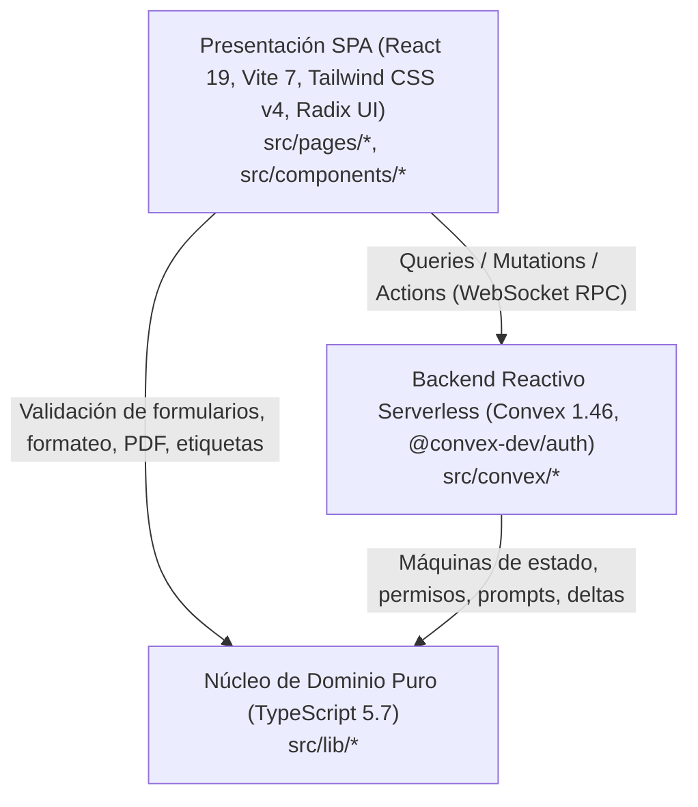

# SPEC-0001 — Visión, Arquitectura y Glosario Ubicuo

- **ID:** `SPEC-0001`
- **Título:** Visión del producto, arquitectura por capas, stack y glosario ubicuo
- **Estado:** Implementada
- **Fecha:** 2026-11-20
- **Fuentes clave:** `AGENTS.md`, `GLOSARIO.md`, `.context/architecture.md`, `.context/specifications.md`, `package.json`, `tests/arquitectura.test.ts`, `tests/especificaciones.test.ts`

---

## 1. Contexto y Objetivos

**Pulso Taller (`GestMant_TS`)** es una aplicación web para la gestión integral de mantenimiento de un taller audiovisual/técnico: recepción de incidencias (públicas o internas), seguimiento por código público, gestión del inventario de equipos y su mantenimiento preventivo, catálogo de repuestos con libro mayor de movimientos, peticiones de repuestos, compras y recepciones con albarán, manuales técnicos y asistente de IA con DeepSeek.

- **En alcance:** Definición estructural por capas (`src/lib/`, `src/convex/`, `src/pages/`, `src/components/`), reglas de dependencia, vocabulario ubicuo obligatorio y trazabilidad con el resto de especificaciones (`SPEC-0002` a `SPEC-0016`).
- **Fuera de alcance:** Detalle de cada módulo operativo (cubierto en `SPEC-0002`..`SPEC-0016`).

---

## 2. Arquitectura por Capas (Clean Architecture + Convex)

### Reglas estructurales verificadas automáticamente
1. **`src/lib/` (Dominio Puro):** cero dependencias de `react`, `react-dom`, `convex` ni `convex/*` (verificado por `tests/arquitectura.test.ts`).
2. **Única fuente de verdad de transiciones:** ninguna mutation de `src/convex/` ni componente UI puede comparar estados literales a mano; deben invocar las máquinas de estado en `src/lib/` (`incidentFlow.ts`, `requestFlow.ts`, `purchaseFlow.ts`, `movements.ts`).
3. **Prohibición de `any`, `eval()`, `new Function()` y `dangerouslySetInnerHTML`** (salvo `src/components/ui/chart.tsx`), verificado por `tests/seguridad.test.ts`.
4. **Sincronía de `api.d.ts`:** todo módulo bajo `src/convex/` debe figurar en `src/convex/_generated/api.d.ts` (verificado por `tests/nasSetup.test.ts`).

---

## 3. Requisitos Funcionales

- **RF-001 (Stack tecnológico):** Frontend en React 19 + TypeScript 5.7 + Vite 7 + Tailwind CSS v4 + Radix UI + CASL (`@casl/ability`, `@casl/react`); backend en Convex (`@convex-dev/auth`); tests en Vitest 5 + `convex-test` + `jsdom`.
- **RF-002 (Glosario ubicuo):** Toda copia visible, documento exportado y código de dominio debe usar los términos canónicos de `GLOSARIO.md`: **incidencia** (no ticket/avería/fallo), **equipo** (no máquina/aparato/dispositivo), **repuesto** (no pieza/recambio/consumible), **petición de repuesto** (no solicitud/pedido interno), **orden de compra**, **parte de trabajo** (no informe de servicio), **técnico** (no mecánico/operario), **aviso** (no alerta).
- **RF-003 (Modularidad de vistas):** Las vistas del dashboard (`src/pages/dashboard/*`) delegan la lógica y subcomponentes en `dialogs/`, `components/`, `hooks/`, `helpers.ts` y `types.ts`, evitando listas largas sin paginación o virtualización (`tests/longLists.test.ts`).
- **RF-004 (Commit por cambio significativo):** Todo cambio significativo validado con `tsc` y `vitest` se registra con `git commit` (`AGENTS.md`).

---

## 4. Reglas de Negocio e Invariantes

- **RN-001:** Ninguna regla de transición de estado puede duplicarse fuera de `src/lib/`.
- **RN-002:** La tabla `securityAuditLog` es inmutable y nunca se incluye en `RESET_TABLES`.
- **RN-003:** No se introducen librerías npm externas cuando el proyecto ya dispone de utilidades nativas (`Intl`, `src/lib/*`).

---

## 5. Permisos y Seguridad

Resumen de gobernanza transversal (detallado en `SPEC-0002` y `SPEC-0013`):
- Toda mutación pública de `src/convex/` verifica identidad y capacidad CASL (vía `secureMutation` o guardas equivalentes), salvo puertas públicas explícitas con rate limiting y reto humano (`incidentIntake`, `incidents.report`, `incidents.byCode`).
- Los secretos de terceros (SMTP, DeepSeek API key) se cifran con AES-256-GCM en `secretCrypto.ts` y nunca regresan al navegador.

---

## 6. Requisitos No Funcionales

- **RNF-001 (Tipado estricto):** `npm run typecheck` debe pasar con `0` errores; ejecuta `tsc -b --noEmit` para la app y `tsc -p src/convex/tsconfig.json --noEmit` para Convex.
- **RNF-002 (Linting):** `npm run lint` (`eslint .`) debe pasar con `0` errores.
- **RNF-003 (Suite en memoria):** Los tests unitarios y de integración con `convex-test` se ejecutan en memoria sin requerir Docker ni red.

---

## 7. Interfaz de Usuario

- **Rutas principales (`src/main.tsx`):** Landing pública (`/`), Notificación pública (`/reportar`), Seguimiento público (`/seguimiento` y `/seguimiento/:codigo`), Autenticación (`/auth`), Panel principal (`/dashboard` con subpestañas por módulo).

---

## 8. Criterios de Aceptación (Gherkin)

- **CA-001 — Aislamiento de dominio puro**
  - **Dado** cualquier archivo `.ts` dentro de `src/lib/`
  - **Cuando** se ejecuta `tests/arquitectura.test.ts`
  - **Entonces** no contiene importaciones de `react`, `react-dom` ni `convex`

- **CA-002 — Transiciones gobernadas por `src/lib/`**
  - **Dado** cualquier módulo de mutación en `src/convex/`
  - **Cuando** se analiza estáticamente en `tests/arquitectura.test.ts`
  - **Entonces** no escribe ni compara estados literales de máquinas de estado fuera de `src/lib/`

---

## 9. Trazabilidad RF → CA → Tests

| Requisito | Criterio | Cobertura automatizada |
|---|---|---|
| RF-001, RN-001 | CA-001, CA-002 | `tests/arquitectura.test.ts` |
| RF-002 | Coherencia terminológica | `tests/especificaciones.test.ts`, `GLOSARIO.md` |
| RF-003 | Control de listas largas | `tests/longLists.test.ts` |
| RN-002 | Seguridad y auditoría | `tests/seguridad.test.ts` |
| RNF-001 | Registro de módulos Convex | `tests/nasSetup.test.ts` |

---

## 10. Preguntas Abiertas / Deuda Técnica

- **Q-001:** Algunas etiquetas históricas en comentarios o archivos de sesión mencionan `GestMant_TS` mientras la interfaz muestra `Pulso Taller`; mantener `Pulso Taller` como nombre comercial único en UI.
