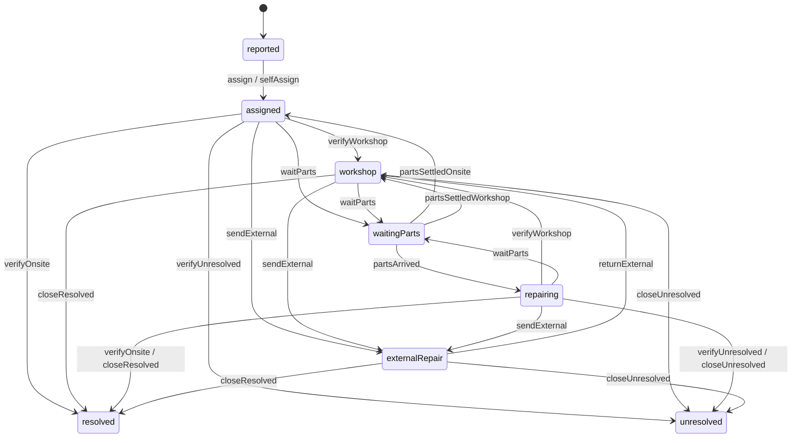

# SPEC-0004 — Gestión de Incidencias

- **ID:** `SPEC-0004`
- **Título:** Ciclo de vida completo de incidencias, taller, reparación externa, notas, expediente y partes
- **Estado:** Implementada
- **Fecha:** 2026-11-20
- **Fuentes clave:** `src/lib/incidentFlow.ts`, `src/lib/incidentJourney.ts`, `src/lib/report.ts`, `src/lib/reportPdf.ts`, `src/lib/reportPackage.ts`, `src/convex/incidents.ts`, `src/convex/_incidents/*`, `src/convex/incidentMail.ts`, `src/pages/dashboard/IncidentsView.tsx`, `src/pages/dashboard/IncidentReportsDialog.tsx`, `src/pages/dashboard/incidents/*`

---

## 1. Contexto y Objetivos

Es la unidad central de trabajo del taller (`INC-XXXX`). Coordina la atención de un fallo desde su entrada hasta su cierre, pasando por verificación en sitio, derivación a taller, espera de repuestos, reparación externa, documentación adjunta y emisión de partes de trabajo.

- **En alcance:** Máquina de 8 estados y 14 transiciones, asignación/autoasignación, notas enriquecidas con diffs, expediente de documentos con log, corrección de datos de equipo, archivo/papelera, partes en Markdown/PDF/ZIP, informes de periodo y correos de estado al notificante.
- **Fuera de alcance:** Notificación inicial anónima (`SPEC-0003`) y asistente IA de incidencias (`SPEC-0012`).

---

## 2. Modelo de Dominio

### Estados (`src/lib/incidentFlow.ts`)
1. `reported` (Nueva)
2. `assigned` (Asignada)
3. `workshop` (En taller)
4. `waitingParts` (En espera de repuestos)
5. `repairing` (En reparación)
6. `externalRepair` (En reparación externa)
7. `resolved` (Resuelta)
8. `unresolved` (Sin resolución)

---

## 3. Requisitos Funcionales

- **RF-001 (Transiciones validadas):** Todas las mutaciones de `incidents.ts` (`assign`, `selfAssign`, `verify`, `assignWorkshop`, `close`, `sendToExternalRepair`, `receiveFromExternalRepair`) consultan `canAdvanceIncident` y registran la entrada en `history`.
- **RF-002 (Sincronización con peticiones):** Al abrir una petición vinculada a una incidencia pasa a `waitingParts`; al entregarse la última petición viva pasa a `repairing` (`partsArrived`), o vuelve a `assigned`/`workshop` si se cancela/rechaza (`partsSettledOnsite` / `partsSettledWorkshop`).
- **RF-003 (Cuaderno y expediente):** Soporta notas con editor rico (`RichTextEditor`) y firma (`SignaturePad`), así como documentos adjuntos (`incidentDocuments`) con trazabilidad en `incidentDocumentLog`.
- **RF-004 (Corrección de datos de equipo):** `incidents.updateEquipment` permite corregir modelo y nº de serie en la incidencia (manualmente o vía escáner IA) dejando rastro en `history`.
- **RF-005 (Partes e informes):** Exportación de parte individual en Markdown, PDF (`reportPdf`) o ZIP con fotos (`reportPackage`), e informes agregados por periodo (`IncidentReportsDialog`).
- **RF-006 (Archivo, papelera y correo):** Soporta archivado y retirada a papelera (`deletedAt`), y envío automático de avisos por correo (`incidentMail`) al notificante según la configuración de audiencia.

---

## 4. Reglas de Negocio e Invariantes

- **RN-001:** Control de concurrencia optimista mediante `expectedUpdatedAt` en ediciones críticas (`tests/incidentConcurrency.test.ts`).
- **RN-002:** Al resolver una incidencia vinculada a un equipo del inventario, queda constancia en su historial de mantenimiento.

---

## 5. Permisos y Seguridad

- Ver la cola: `viewIncidents`.
- Autoasignarse: técnicos que ven la cola en incidencias `reported`.
- Asignar a otros, derivar, cerrar, gestionar expediente, archivar/retirar: `manageIncidents`.

---

## 6. Requisitos No Funcionales

- **RNF-001:** Paginación y vistas compactas/normales en la cola (`IncidentsList`) respetando `tests/longLists.test.ts`.
- **RNF-002 (Proyección ligera CQRS):** `incidents.list` y `incidents.paginatedList` omiten firmar `documents[].url` por defecto (`includeDocumentUrls?: boolean`), mientras que `incidents.detail({ incidentId })` resuelve las URLs de los documentos del expediente bajo demanda al abrir `IncidentDetailSheet`.

---

## 7. Interfaz de Usuario

- `IncidentsView.tsx`: barra de filtros por estado con contadores, buscador/ordenación, lista por secciones, botón **Informes del periodo** y botón **Consultar IA** (cuando disponible).
- `IncidentDetailSheet.tsx`: ficha lateral con datos del equipo, acciones de flujo, cuaderno de notas, peticiones vinculadas, documentos del expediente, firma y exportación de parte.

---

## 8. Criterios de Aceptación (Gherkin)

- **CA-001 — Transición ilegal rechazada**
  - **Dado** una incidencia en estado `reported`
  - **Cuando** se intenta cerrar directamente sin pasar por asignación/verificación
  - **Entonces** `canAdvanceIncident` lo rechaza y la mutación lanza `ConvexError`

- **CA-002 — Espera automática por petición**
  - **Dado** una incidencia `assigned`
  - **Cuando** se crea una petición de repuesto vinculada (`incidentId`)
  - **Entonces** la incidencia pasa a `waitingParts` y registra el hito en `history`

---

## 9. Trazabilidad RF → CA → Tests

| Requisito | Criterio | Cobertura automatizada |
|---|---|---|
| RF-001, CA-001 | Máquina de estados y transiciones | `tests/incidentFlow.test.ts`, `tests/incidentJourney.test.ts`, `tests/incidents.test.ts`, `tests/maquinas.test.ts` |
| RF-002, CA-002 | Sincronía con peticiones | `tests/incidentPartRequests.test.tsx`, `tests/incidentPartRequestsCardHelpers.test.ts` |
| RF-003, RN-001 | Notas, expediente y concurrencia | `tests/incidentConcurrency.test.ts`, `tests/incidentDocumentsCardHelpers.test.ts`, `tests/incidentNotesCardHelpers.test.ts` |
| RF-004 | Corrección de equipo en incidencia | `tests/incidentEquipment.test.tsx`, `tests/incidentEquipmentCardHelpers.test.ts` |
| RF-005 | Partes Markdown/PDF/ZIP e informes | `tests/report.test.ts`, `tests/reportPdf.test.ts`, `tests/reportPackage.test.ts`, `tests/incidentReportsHelpers.test.ts` |
| RF-006 | Archivo, papelera y correo | `tests/incidentMail.test.ts`, `tests/incidentsViewFlow.test.tsx` |

---

## 10. Preguntas Abiertas / Deuda Técnica

- Ninguna abierta; la máquina `INCIDENT_STEPS` está sincronizada automáticamente con `MAQUINAS.md` mediante `tests/maquinas.test.ts`.
