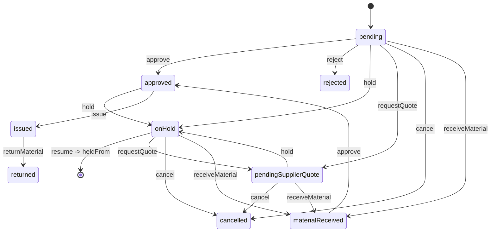

# SPEC-0007 — Peticiones de Repuestos (`PET-XXXX`)

- **ID:** `SPEC-0007`
- **Título:** Peticiones de repuestos, máquina de estados, entregas parciales, devoluciones y archivo
- **Estado:** Implementada
- **Fecha:** 2026-11-20
- **Fuentes clave:** `src/lib/requestFlow.ts`, `src/lib/requestJourney.ts`, `src/convex/partRequests.ts`, `src/convex/_partRequests/*`, `src/pages/dashboard/RequestsView.tsx`, `src/pages/dashboard/requests/*`

---

## 1. Contexto y Objetivos

Gestiona las solicitudes de material del taller (`PET-XXXX`), su aprobación con reserva de stock, entregas totales o parciales por línea, suspensiones con memoria de origen (`heldFrom`), devoluciones, cancelaciones, archivo y papelera, así como la sincronización automática con la incidencia asociada (`waitingParts` ↔ `repairing`).

---

## 2. Modelo de Dominio

### Estados (`src/lib/requestFlow.ts`)
- `pending` (Pendiente)
- `onHold` (Suspendida, recuerda `heldFrom`)
- `pendingSupplierQuote` (Esperando presupuesto externo)
- `materialReceived` (Material recibido)
- `approved` (Aprobada — stock descontado)
- `issued` (Entregada)
- `returned` (Devuelta)
- `rejected` (Rechazada)
- `cancelled` (Cancelada)

---

## 3. Requisitos Funcionales

- **RF-001 (Alta y líneas):** `partRequests.create` valida líneas, asigna `PET-XXXX`, vincula opcionalmente `equipmentId` e `incidentId`, y pone la incidencia en `waitingParts` (`holdIncidentForParts`).
- **RF-002 (Asociación tardía):** En estado `pending`, `associateExisting` / `associateNew` permiten vincular repuestos del catálogo o crear uno nuevo antes de aprobar.
- **RF-003 (Aprobación y stock):** `approve` verifica existencias de todas las líneas, descuenta `spareParts.stock`, registra `stockMovements` (`request_reserve`, `SPEC-0006`) y crea entrada en `requestDecisions`.
- **RF-004 (Entrega total/parcial):** `markIssued` entrega todo; `issueLines` entrega cantidades parciales por línea pasando a `issued` al completar la última unidad.
- **RF-005 (Suspensión con memoria `heldFrom`):** `onHold` guarda desde qué estado salió (`heldFrom`) y `resume` devuelve exactamente a ese estado (evitando re-aprobar una petición ya descontada).
- **RF-006 (Devolución, rechazo, cancelación y papelera):** `returnMaterial`, `reject`, `cancel`, archivado (`archive`/`unarchive`/`archiveDecidedBefore`) y papelera (`_partRequests/trash.ts`, purga cron `05:30` UTC).

---

## 4. Reglas de Negocio e Invariantes

- **RN-001:** Toda transición pasa por `nextRequestStatus(status, action, heldFrom)` en `src/lib/requestFlow.ts`.
- **RN-002:** No se puede aprobar una petición con líneas sin `sparePartId` asociado ni con stock insuficiente.

---

## 5. Permisos y Seguridad

- Ver peticiones: `viewRequests`.
- Crear peticiones y adjuntar fotos/documentos: `createRequests`.
- Aprobar, rechazar, suspender, entregar, devolver o archivar: `decideRequests`.

---

## 6. Requisitos No Funcionales

- **RNF-001:** Validación de subidas de adjuntos por *magic bytes* (`uploads.ts`).

---

## 7. Interfaz de Usuario

- `RequestsView.tsx`: filtros por estado, búsqueda, paginación, `NewRequestDialog`, `RequestDetailSheet`, `AssociatePartDialog`, `RequestIssueDialog`, `DecisionDialog`.

---

## 8. Criterios de Aceptación (Gherkin)

- **CA-001 — Suspender y reanudar sin doble descuento**
  - **Dado** una petición en estado `approved` (stock ya descontado)
  - **Cuando** se suspende (`hold`) y después se reanuda (`resume`)
  - **Entonces** vuelve a `approved` (no a `pending`) y no permite aprobar de nuevo

---

## 9. Trazabilidad RF → CA → Tests

| Requisito | Criterio | Cobertura automatizada |
|---|---|---|
| RF-005, CA-001, RN-001 | Máquina de estados | `tests/requestFlow.test.ts`, `tests/requestJourney.test.ts`, `tests/maquinas.test.ts` |
| RF-001..RF-004 | Stock, líneas y entrega parcial | `tests/requestLinesStock.test.ts`, `tests/requestIssueDialog.test.tsx`, `tests/stockMovements.test.ts` |
| RF-006 | Papelera y archivo | `tests/requestTrash.test.ts`, `tests/requestsViewFlow.test.tsx`, `tests/requestsViewHelpers.test.ts` |

---

## 10. Preguntas Abiertas / Deuda Técnica

- **Q-001:** `partRequests` guarda `requestDecisions` y timestamps sueltos, pero no un array `history` completo de cada transición como `incidents.history` (Fase 5 opcional de `movements_and_traceability_plan.md`).
