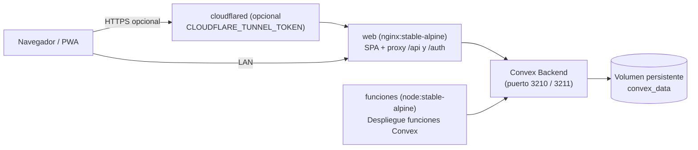

# SPEC-0014 — Infraestructura, Despliegue y Operaciones

- **ID:** `SPEC-0014`
- **Título:** Entorno local Windows/Docker, despliegue Synology NAS, Cloudflare Tunnel, scripts operativos y crons
- **Estado:** Implementada
- **Fecha:** 2026-11-20
- **Fuentes clave:** `start.ps1`, `scripts/local-dev.mjs`, `scripts/nas-setup.mjs`, `scripts/nas-backup.mjs`, `scripts/nas-clave.mjs`, `scripts/generate-keys.mjs`, `scripts/update-version.mjs`, `docker/convex/docker-compose.yml`, `docker/synology/Dockerfile`, `docker/synology/docker-compose.yml`, `docker/synology/funciones.sh`, `docker/synology/vigila-funciones.sh`, `src/convex/crons.ts`, `src/convex/health.ts`

---

## 1. Contexto y Objetivos

Permite ejecutar Pulso Taller de forma 100% autoalojada tanto en desarrollo local (Windows/Docker via `start.ps1` + `scripts/local-dev.mjs`) como en producción sobre un NAS Synology (`docker/synology/*`), con túnel seguro opcional (`cloudflared`), copias de seguridad y tareas programadas (`crons.ts`).

---

## 2. Arquitectura de Despliegue

---

## 3. Requisitos Funcionales

- **RF-001 (Orquestador local `start.ps1` + `local-dev.mjs`):** Comprueba Node/Docker, levanta contenedores de `docker/convex/`, prepara `.env.local` y claves JWT/JWKS, lanza el observador de `src/convex/` y Vite (`5173`). Soporta `-Repair`, `-Fresh`, `-Check`, `-Stop`, `-NoOpen` y `-TakeOver`.
- **RF-002 (Despliegue Synology `docker/synology/`):** Contenedores basados en `nginx:stable-alpine` y `node:stable-alpine` con `apk upgrade --no-cache`, scripts `funciones.sh` / `vigila-funciones.sh` / `copia-previa.sh`, variables opcionales `DEEPSEEK_API_KEY`, `PULSO_TURNSTILE_SITE_KEY`, `PULSO_TURNSTILE_SECRET_KEY`, `PULSO_CHALLENGE_SECRET`, `PULSO_SETTINGS_ENCRYPTION_KEY` y `CLOUDFLARE_TUNNEL_TOKEN`.
- **RF-003 (Sondas de salud `health.ts`):** Expone `/healthz` y `/readyz` para monitorización de contenedores.
- **RF-004 (Tareas programadas `crons.ts`):**
  - `03:15` UTC: `archive.runAutoArchive`
  - `03:45` UTC: `reportUploads.warnUnused`
  - `04:00` UTC: `reportUploads.sweepUnused`
  - `04:30` UTC: `storageCleanup.sweepOrphanFiles`
  - `05:00` UTC: `trash.purgeExpired`
  - `05:15` UTC: `incidents.purgeExpired`
  - `05:30` UTC: `partRequests.purgeExpired`
  - `05:45`–`06:00` UTC: purga de tablas efímeras (`publicLookupLimits`, `otpLimits`, `humanChallenge`, `ai.purgeExpiredUsage`)
  - `07:00` UTC: `weeklyReport.runScheduled`
  - Cada `15` min: `publicStats.refresh`
- **RF-005 (Backups y versionado):** `scripts/nas-backup.mjs` genera copias consistentes; `scripts/update-version.mjs` sincroniza versión y changelog.

---

## 4. Reglas de Negocio e Invariantes

- **RN-001:** Los secretos de entorno viven en `.env.local` o `.env` del NAS y nunca se comitean al repositorio.
- **RN-002:** Las imágenes Alpine actualizan paquetes en construcción con `apk upgrade --no-cache`.

---

## 5. Permisos y Seguridad

- La clave de administración de Convex (`CONVEX_ADMIN_KEY`) solo se usa en scripts de despliegue locales/NAS y nunca llega al bundle del navegador.

---

## 6. Requisitos No Funcionales

- **RNF-001:** Soporte PWA (`vite-plugin-pwa`) con `autoUpdate` en compilación de producción (`src/main.tsx`).

---

## 7. Interfaz de Usuario

- `ApiAddressNotice.tsx`: avisa al usuario en pantalla si `VITE_CONVEX_URL` no responde.
- `ChangelogDialog.tsx`: muestra novedades por versión.

---

## 8. Criterios de Aceptación (Gherkin)

- **CA-001 — Parada limpia en local**
  - **Dado** el entorno local arrancado con `.\start.ps1`
  - **Cuando** el usuario ejecuta `.\start.ps1 -Stop`
  - **Entonces** se detienen el servidor Vite y el observador de Convex iniciados por el script

---

## 9. Trazabilidad RF → CA → Tests

| Requisito | Criterio | Cobertura automatizada |
|---|---|---|
| RF-001, CA-001 | Orquestador local y salud | `tests/localDev.test.ts`, `tests/health.test.ts`, `tests/apiAddress.test.ts` |
| RF-002 | Configuración y scripts NAS | `tests/nasSetup.test.ts`, `tests/nasDoctor.test.ts`, `tests/nasClave.test.ts`, `tests/nasBackup.test.ts` |
| RF-004 | Planificación de crons | `tests/crons.test.ts` |
| RF-005 | Changelog y versión | `tests/changelog.test.ts`, `tests/changelogDialogHelpers.test.ts` |

---

## 10. Preguntas Abiertas / Deuda Técnica

- Ninguna abierta; la verificación de despliegue vivo en NAS en `nasSetup.test.ts` se salta automáticamente en tests en memoria.
