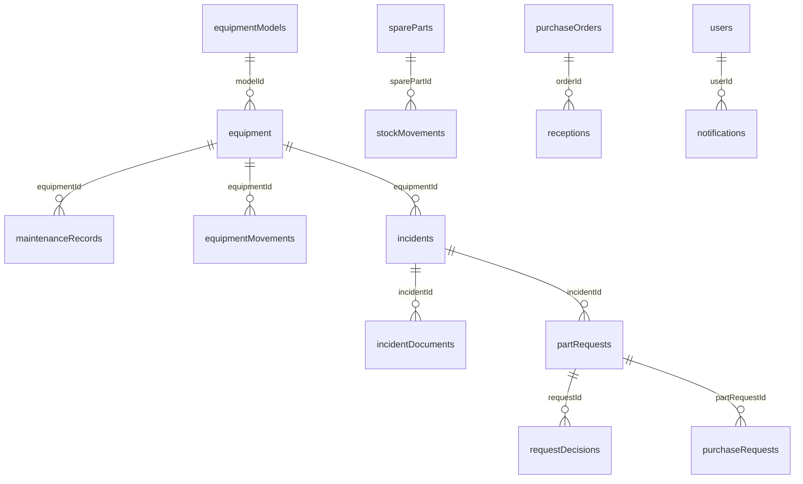

# SPEC-0016 — Modelo de Datos Convex (`schema.ts`) y Mapa de API

- **ID:** `SPEC-0016`
- **Título:** Esquema completo de tablas, índices, relaciones, referencias correlativas y módulos Convex
- **Estado:** Implementada
- **Fecha:** 2026-11-20
- **Fuentes clave:** `src/convex/schema.ts`, `src/convex/references.ts`, `src/convex/workshopReset.ts`, `src/convex/_generated/api.d.ts`

---

## 1. Contexto y Objetivos

Documenta el modelo de persistencia completo en `src/convex/schema.ts`, la generación atómica de referencias (`referenceCounters`), el conjunto de tablas reiniciables (`RESET_TABLES`) frente a las de configuración/auditoría, y la organización modular de `src/convex/`.

---

## 2. Modelo Entidad-Relación (Núcleo Operativo)

---

## 3. Catálogo de Tablas (`src/convex/schema.ts`)

### A. Dominio operativo (reiniciables en `RESET_TABLES`)

`spareParts`, `stockMovements`, `equipment`, `equipmentMovements`, `equipmentModels`, `incidents`, `incidentDocuments`, `incidentDocumentLog`, `partRequests`, `requestDecisions`, `purchaseRequests`, `purchaseOrders`, `receptions`, `maintenanceRecords`, `manuals`, `mailShares`, `notifications`, `messages`, `reportUploads`, `storageCleanupRuns`, `reportUploadPurges`, `trashFiles`, `weeklyReports`, `catalogs`, `appSettings`, `publicStats`.

### B. Efímeras y control de tasa (incluidas en `RESET_TABLES` + purga cron)

`publicLookupLimits`, `otpSendLimits`, `publicChallengeUsed`, `aiUsageLimits`.

### C. Identidad, configuración y auditoría (excluidas de `RESET_TABLES`)

- `users`, `roles`, `referenceCounters`
- `storageSettings`, `alertSettings`, `auditAlertSettings`, `reportSettings`, `archiveSettings`, `mailSettings`, `aiSettings`
- `mailLog`, **`securityAuditLog`** (inmutable, nunca se purga).

---

## 4. Requisitos Funcionales

- **RF-001 (Contadores atómicos `references.ts`):** `referenceCounters` asigna referencias correlativas únicas sin colisiones (`INC-XXXX`, `PET-XXXX`, `PC-XXXX`, `OC-XXXX`, `EQ-XXX`).
- **RF-002 (Organización modular `src/convex/`):** Helpers internos agrupados en `_ai/`, `_auth/`, `_incidents/`, `_inventory/`, `_mail/`, `_partRequests/`, `_purchasing/`, expuestos solo mediante `internalQuery`/`internalMutation` o funciones de dominio.
- **RF-003 (Registro estático de tipos):** Toda nueva función o módulo bajo `src/convex/` debe quedar declarado en `src/convex/_generated/api.d.ts` (validado automáticamente por `tests/nasSetup.test.ts`). El índice se regenera con `npx convex codegen` contra un deployment activo.
- **RF-004 (Consultas indexadas de alto tráfico):**
  - `partRequests` declara el índice `by_equipment` (`["equipmentId"]`) para desvinculación (`equipment.remove`) y consultas por equipo (`equipment.relatedSummary`) sin escaneo completo.
  - `dashboard.summary` consulta `dashboardStats` en paralelo con solo los estados en curso (`STALE_WORK_CANDIDATE_STATUSES`) mediante `incidents.by_lifecycle_status` (cubriendo `lifecycle: "active"` y filas legacy sin `lifecycle`), evitando leer incidencias cerradas, archivadas o en papelera.
  - `equipment.ts` vincula incidencias sin equipo usando `incidents.by_equipment_and_created` (`equipmentId === undefined`) en lugar de `.filter(...)`.

---

## 5. Reglas de Negocio e Invariantes

- **RN-001:** Ninguna tabla operativa con `deletedAt` se borra físicamente en la acción de usuario; primero pasa a papelera y solo vence en cron tras expirar retención.
- **RN-002:** `securityAuditLog` jamás entra en `RESET_TABLES`.
- **RN-003:** `mailShares` viaja en el backup solo como metadatos (`src/lib/backup.ts`): sin extracto, cuerpo, adjuntos ni `.eml`. Las referencias `destinationId` y `sharedBy` sí viajan para remapear la ficha. Una copia sin destino restaurado se omite y se registra `mail_share_restore_skip`; las restauradas vuelven como `summary` con `backupRestored: true`.

---

## 6. Trazabilidad RF → Tests

| Requisito | Cobertura automatizada                                                                     |
| --------- | ------------------------------------------------------------------------------------------ |
| RF-001    | `tests/references.test.ts`                                                                 |
| RF-003    | `tests/nasSetup.test.ts`                                                                   |
| RN-002    | `tests/workshopReset.test.ts`, `tests/seguridad.test.ts`, `tests/mailSharesBackup.test.ts` |
| RN-003    | `tests/mailSharesBackup.test.ts`                                                           |

---

## 7. Preguntas Abiertas / Deuda Técnica

- Sin deuda abierta.
