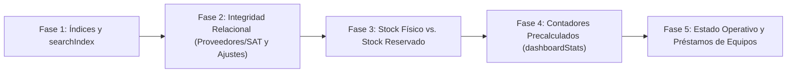

# Plan de Mejoras de Base de Datos, Rendimiento y Trazabilidad
**Proyecto:** Pulso Taller (`GestMant_TS`) — Sistema de Gestión de Mantenimiento  
**Versión del Plan:** 1.0.0  
**Fecha de Creación:** 2026-11-23  
**Estado:** Pendiente de ejecución  

---

## 1. Resumen Ejecutivo y Alcance

Este plan define una hoja de ruta incremental en **5 fases** sobre [`src/convex/schema.ts`](../src/convex/schema.ts) y sus adaptadores de negocio para:
1. **Índices y rendimiento:** reducir escaneos `.collect()` + `.filter()`, añadir `by_serialNumber`, `by_kind` en `stockMovements`, índices de ciclo de vida en `incidents`/`partRequests` y `searchIndex` en tablas operativas.
2. **Integridad relacional y conexión con el catálogo ampliado:** enlazar `supplierId` / `externalWorkshopId` (`Id<"catalogs">`) en repuestos, equipos, compras y reparaciones externas, y consolidar las tablas singleton de ajustes no sensibles.
3. **Stock físico vs. Stock reservado/disponible:** distinguir existencias reales en estantería frente a unidades comprometidas en peticiones aprobadas.
4. **Contadores precalculados (`dashboardStats`):** evitar barridos completos en `src/convex/dashboard.ts` manteniendo métricas incrementales sincronizadas.
5. **Estado operativo y préstamos temporales de equipos:** añadir estado operativo en `equipment` (`operationalState`) y soporte explícito de préstamos temporales en `equipmentMovements` / `equipment`.

---

## 2. Invariantes y Guardrails (`AGENTS.md`)

> [!IMPORTANT]
> - **Retrocompatibilidad de Esquema:** Todo nuevo campo en tablas existentes debe ser `v.optional(...)` para no romper documentos históricos ni copias de seguridad previas (`workshopBackup.ts`).
> - **Aislamiento de Capas:** Las reglas puras (cálculo de stock disponible, transiciones de préstamo/estado operativo, cálculo de deltas de contadores) deben vivir en `src/lib/` sin importar React ni Convex (`tests/arquitectura.test.ts`).
> - **Seguridad (`secureMutation`):** Toda nueva mutación o consulta debe respetar los guardrails de `tests/seguridad.test.ts` y mantener `securityAuditLog` inmutable.
> - **Backup y Reset:** Cualquier tabla nueva (p. ej. `dashboardStats`, `workshopSettings`) debe contemplarse en `workshopBackup.ts` y `workshopReset.ts` según corresponda.
> - **Finales de Línea:** Todo archivo guardado debe usar LF (`tests/finalesDeLinea.test.ts`).

---

## 3. Hoja de Ruta por Fases

---

### Fase 1: Índices y Rendimiento (`schema.ts` y consultas críticas)
*Objetivo: Eliminar barridos completos en las consultas más frecuentes manteniendo exactamente los mismos contratos de salida.*

- **Archivos a modificar:**
  - `src/convex/schema.ts`
  - `src/convex/equipment.ts`
  - `src/convex/incidents.ts`
  - `src/convex/partRequests.ts`
  - `src/convex/search.ts`
  - `src/convex/stockMovements.ts`
- **Acciones específicas:**
  1. **`equipment`:** añadir `.index("by_serialNumber", ["serialNumber"])` y `.index("by_supplier", ["supplier"])`; usar `by_serialNumber` al comprobar duplicados y en `linkMatchingIncidents`.
  2. **`spareParts`:** añadir `.index("by_supplier", ["supplier"])`.
  3. **`stockMovements`:** añadir `.index("by_kind", ["kind", "createdAt"])` para acelerar filtros por tipo de movimiento (consumo, recepción, ajuste).
  4. **Índices compuestos de ciclo de vida en `incidents` y `partRequests`:**
     - Añadir campo opcional `lifecycle: v.optional(v.union(v.literal("active"), v.literal("archived"), v.literal("trashed")))` con índices `by_lifecycle_status` (`["lifecycle", "status"]`) y `by_lifecycle_createdAt` (`["lifecycle", "createdAt"]`).
     - Mantener sincronizado `lifecycle` en altas, archivado, restauración y papelera; incluir una migración idempotente (`backfillLifecycle`) o fallback seguro mientras haya registros sin `lifecycle`.
  5. **Búsqueda en servidor (`searchIndex`):**
     - Añadir `.searchIndex("search_text", ...)` en `incidents` (`description`), `equipment` (`name`), `spareParts` (`name`), `partRequests` (`description`) y `manuals` (`title`), y adaptar `src/convex/search.ts` para aprovecharlos en búsquedas por texto.
- **Verificación:**
  - `npm run typecheck`
  - `npx vitest run tests/incidents.test.ts tests/equipos.test.ts tests/repuestos.test.ts tests/stockMovements.test.ts tests/publicLookupSecurity.test.ts tests/arquitectura.test.ts tests/seguridad.test.ts`

---

### Fase 2: Integridad Relacional y Conexión con el Catálogo Ampliado
*Objetivo: Conectar compras, repuestos, equipos y reparaciones externas con la ficha de contacto del proveedor/SAT en `catalogs`, y simplificar los ajustes singleton.*

- **Archivos a modificar:**
  - `src/convex/schema.ts`
  - `src/convex/catalogs.ts`
  - `src/convex/spareParts.ts`
  - `src/convex/equipment.ts`
  - `src/convex/purchasing.ts` (y `_purchasing/`)
  - `src/convex/incidents.ts` (`sendToExternal`)
  - `src/convex/workshopBackup.ts`, `src/convex/workshopReset.ts`
  - Componentes UI de detalle (`PartDetailSheet.tsx`, `OrderSheet.tsx`, `IncidentExternalRepairSection.tsx`)
- **Acciones específicas:**
  1. **Enlaces `Id<"catalogs">` opcionales:**
     - Añadir `supplierId: v.optional(v.id("catalogs"))` en `spareParts`, `equipment`, `equipmentModels`, `purchaseRequests`, `purchaseOrders` y `receptions`.
     - Añadir `externalWorkshopId: v.optional(v.id("catalogs"))` en `incidents.externalRepair`.
     - Al guardar desde backend (`ensureItem` o resolución por `by_kind_normalized`), rellenar automáticamente `supplierId` / `externalWorkshopId` manteniendo el campo `supplier` / `companyName` como etiqueta legible.
     - En `propagateCatalogRename`, aprovechar los nuevos índices (`by_supplierId` / `by_supplier`) en lugar de `.collect()` completos.
  2. **Tarjeta/Popover rápido de contacto en UI:**
     - En `OrderSheet`, `PartDetailSheet` e `IncidentExternalRepairSection`, si existe `supplierId` / `externalWorkshopId` con datos en `catalogs`, mostrar dirección, personas de contacto y enlaces `tel:` / `mailto:`.
  3. **Consolidación gradual de ajustes no sensibles:**
     - Crear tabla `workshopSettings` (`section: string`, `payload: string / object`, `updatedAt: number`, `.index("by_section", ["section"])`) para unificar `appSettings`, `storageSettings`, `alertSettings`, `auditAlertSettings`, `reportSettings`, `weeklyReports`, `archiveSettings` y `aiSettings` (manteniendo `mailSettings` aislada por contener secretos AES-256-GCM).
     - Proveer lectura con fallback a las tablas previas y migración transparente en escritura hasta retirar las tablas antiguas.
- **Verificación:**
  - `npm run typecheck`
  - `npx vitest run tests/catalogs.test.ts tests/catalogsCard.test.tsx tests/compras.test.ts tests/partDetailSheet.test.tsx tests/workshopBackup.test.ts tests/workshopReset.test.ts`

---

### Fase 3: Stock Físico vs. Stock Reservado / Disponible
*Objetivo: Evitar roturas de stock por peticiones simultáneas diferenciando las existencias físicas en almacén del stock comprometido.*

- **Archivos a crear / modificar:**
  - `src/lib/workshop.ts` (o `src/lib/inventoryStock.ts` puro)
  - `src/convex/schema.ts`
  - `src/convex/spareParts.ts`
  - `src/convex/partRequests.ts` y `src/convex/_partRequests/`
  - `src/pages/dashboard/inventory/components/PartRow.tsx`
  - `src/pages/dashboard/inventory/components/PartDetailSheet.tsx`
  - `src/pages/dashboard/requests/components/detail/`
- **Acciones específicas:**
  1. **Lógica pura en `src/lib/`:**
     - Funciones puras `availableStock(stock, reservedStock)` (`Math.max(0, stock - (reservedStock ?? 0))`) y `computeReservedDelta(prevStatus, nextStatus, lines)` según la máquina de estados de `requestFlow.ts`.
  2. **Esquema y backend:**
     - Añadir `reservedStock: v.optional(v.number())` en `spareParts`.
     - Cuando una `partRequest` pasa a estado aprobado/pendiente de entrega (`approved` / `materialReceived` con material en almacén), incrementar `reservedStock`; al entregar (`issued`), cancelar o devolver, decrementar `reservedStock` de forma atómica en la misma mutación.
     - Añadir mutación/acción interna de recálculo idempotente (`reconcileReservedStock`) a partir de peticiones activas para garantizar consistencia tras restauraciones o migraciones.
  3. **Interfaz:**
     - Mostrar en `PartRow` y `PartDetailSheet` el desglose: **Físico** / **Reservado** / **Disponible** cuando `reservedStock > 0`, y usar el stock disponible como referencia en las alertas y al aprobar nuevas peticiones.
- **Verificación:**
  - `npm run typecheck`
  - `npx vitest run tests/repuestos.test.ts tests/requestLinesStock.test.ts tests/partDetailSheet.test.tsx tests/requestsViewFlow.test.tsx tests/arquitectura.test.ts`

---

### Fase 4: Contadores Precalculados (`dashboardStats`)
*Objetivo: Reducir el número de lecturas reactivas en `src/convex/dashboard.ts` y mejorar la latencia del panel resumen y las insignias de navegación.*

- **Archivos a crear / modificar:**
  - `src/convex/schema.ts`
  - `src/convex/_stats/dashboardStats.ts` (helpers transaccionales)
  - `src/convex/dashboard.ts`
  - Mutaciones de ciclo de vida en `incidents.ts`, `partRequests.ts`, `purchasing.ts`, `spareParts.ts`, `equipment.ts`, `workshopReset.ts`, `workshopBackup.ts`
- **Acciones específicas:**
  1. **Tabla `dashboardStats`:**
     - Documento único (`key: "global"`, `.index("by_key", ["key"])`) con contadores agregados:
       - `incidentsByStatus` (activas por estado)
       - `requestsByStatus` (activas por estado)
       - `lowStockPartsCount` y `outOfStockPartsCount`
       - `pendingPurchaseRequestsCount` y `openPurchaseOrdersCount`
       - `overdueMaintenanceCount` (o recalculado por cron diario)
       - `updatedAt: number`
  2. **Actualización incremental y reconciliación:**
     - Helper transaccional `adjustDashboardStats(ctx, delta)` llamado en las transiciones de estado y altas/bajas.
     - Fallback / reconstrucción automática (`rebuildDashboardStats`) al restaurar copia de seguridad, resetear taller o ejecutar `crons.ts` nocturno.
  3. **Consumo en `dashboard.ts`:**
     - Servir los contadores de resumen directamente desde `dashboardStats` (1 lectura de documento en lugar de múltiples `.collect()`).
- **Verificación:**
  - `npm run typecheck`
  - `npx vitest run tests/dashboardSummary.test.ts tests/dashboardSeedAndAlerts.test.tsx tests/crons.test.ts tests/workshopBackup.test.ts tests/workshopReset.test.ts`

---

### Fase 5: Estado Operativo y Préstamos Temporales de Equipos
*Objetivo: Dar visibilidad inmediata en inventario sobre qué equipos están operativos, en taller, en SAT externo o prestados temporalmente.*

- **Archivos a crear / modificar:**
  - `src/lib/movements.ts`
  - `src/convex/schema.ts`
  - `src/convex/equipment.ts`
  - `src/convex/incidents.ts`
  - `src/pages/dashboard/equipment/` (`EquipmentTableRow.tsx`, `EquipmentDetailSheet.tsx`, nuevo diálogo `EquipmentLoanDialog.tsx`)
- **Acciones específicas:**
  1. **Esquema en `equipment` y `equipmentMovements`:**
     - Añadir en `equipment`:
       - `operationalState: v.optional(v.union(v.literal("operational"), v.literal("in_workshop"), v.literal("external_repair"), v.literal("loaned"), v.literal("decommissioned")))`
       - `currentLoan: v.optional(v.object({ borrowerName: v.string(), location: v.optional(v.string()), loanedAt: v.number(), expectedReturnAt: v.optional(v.number()), notes: v.optional(v.string()) }))`
     - Ampliar `equipmentMovements.kind` con `"loan_out"` y `"loan_return"` (y campos opcionales `borrowerName`, `expectedReturnAt`).
  2. **Sincronización automática con Incidencias:**
     - Cuando una incidencia vinculada a `equipmentId` entra en `workshop` → `operationalState = "in_workshop"`; en `externalRepair` → `"external_repair"`; al resolverse/cerrarse (si no hay otra incidencia activa sobre el mismo equipo) → vuelve a `"operational"`.
     - Si el equipo tiene `decommissionDate` → `"decommissioned"`.
  3. **Flujo de préstamo temporal en UI y Backend:**
     - Mutaciones `equipment.loanOut` y `equipment.returnLoan` protegidas con `secureMutation` (`manageEquipment`), registrando el movimiento correspondiente en `equipmentMovements`.
     - Mostrar badge de estado operativo en `EquipmentTableRow` y tarjeta de préstamo activo (con botón **Registrar devolución** / **Prestar equipo**) en `EquipmentDetailSheet`.
- **Verificación:**
  - `npm run typecheck`
  - `npx vitest run tests/movements.test.ts tests/movementsUi.test.tsx tests/equipmentMovements.test.ts tests/equipos.test.ts tests/incidents.test.ts tests/arquitectura.test.ts tests/seguridad.test.ts`
