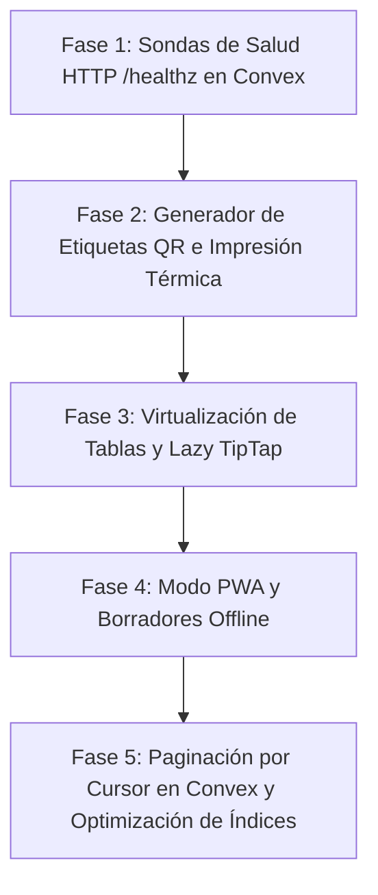

# Plan de Mejoras Operativas, Resiliencia y Escalabilidad
**Proyecto:** Pulso Taller (`GestMant_TS`) — Sistema de Gestión de Mantenimiento  
**Versión del Plan:** 1.0.0  
**Fecha de Creación:** 2026-10-23  
**Estado:** Listo para ejecución  

---

## 1. Resumen Ejecutivo y Alcance

Este plan complementa la modernización arquitectónica del proyecto introduciendo 5 pilares operativos y de resiliencia industrial, diseñados específicamente para el entorno físico de trabajo de los **Técnicos** de mantenimiento (talleres, salas de máquinas, sótanos técnicos y almacenes AV):

1. **Sondas de Observabilidad y Salud en Servidor (`/healthz` y `/readyz`):** Monitoreo continuo de contenedores Docker en NAS Synology y Proxmox para evitar caídas silenciosas.
2. **Generación e Impresión de Etiquetas Físicas QR / Código de Barras:** Identificación de **Equipos** y **Repuestos** en estanterías mediante plantillas vectoriales e impresoras térmicas (Zebra / Brother / ESC/POS).
3. **Rendimiento y Virtualización de Tablas:** Soporte para catálogos masivos con `@tanstack/react-virtual` y carga bajo demanda del editor de texto TipTap.
4. **Resiliencia Industrial y Modo PWA:** Capacidad de consultar manuales PDF descargados y redactar borradores de **Incidencias** en zonas sin cobertura Wi-Fi/4G.
5. **Escalabilidad de Consultas Reactivas en Convex:** Migración de barridos `.collect()` a paginación por cursor e índices compuestos para expedientes históricos y auditoría.

---

## 2. Invariantes y Guardrails de Gobernanza (`AGENTS.md`)

> [!IMPORTANT]
> - **Aislamiento de Capas:** La lógica de formateo de etiquetas, conversión de coordenadas QR o generación de borradores offline debe residir en [src/lib/](file:///e:/Users/kaoti/Documentos/GitHub/repuestos-taller-web/src/lib/) sin dependencias de React ni Convex.
> - **Vocabulario Ubicuo:** Obligatorio en toda la interfaz y código: **Incidencia**, **Equipo**, **Petición de repuesto**, **Parte de trabajo**, **Técnico**.
> - **Seguridad y Auditoría:** Toda impresión de etiquetas con identificadores de seguridad o modificación de inventario debe registrarse en `securityAuditLog`.

---

## 3. Hoja de Ruta por Fases (Estrategia Incremental)



---

### Fase 1: Sondas de Observabilidad HTTP (`/healthz` y `/readyz`)
*Objetivo: Permitir que Docker, Nginx y los scripts de diagnóstico (`nas-doctor-lib.mjs`) verifiquen el estado real del backend sin depender de peticiones WebSocket autenticadas.*

- **Archivos a modificar:**
  - [src/convex/http.ts](file:///e:/Users/kaoti/Documentos/GitHub/repuestos-taller-web/src/convex/http.ts)
  - [scripts/nas-doctor-lib.mjs](file:///e:/Users/kaoti/Documentos/GitHub/repuestos-taller-web/scripts/nas-doctor-lib.mjs)
  - `docker/convex/docker-compose.yml`

- **Acciones específicas:**
  1. Definir endpoint `GET /healthz` en [src/convex/http.ts](file:///e:/Users/kaoti/Documentos/GitHub/repuestos-taller-web/src/convex/http.ts) que devuelva status `200 OK` con timestamp y versión del sistema:
     ```typescript
     http.route({
       path: "/healthz",
       method: "GET",
       handler: httpAction(async () => {
         return new Response(JSON.stringify({ status: "healthy", timestamp: Date.now() }), {
           status: 200,
           headers: { "Content-Type": "application/json" },
         });
       }),
     });
     ```
  2. Definir endpoint `GET /readyz` que ejecute una lectura rápida en la base de datos para confirmar que el almacenamiento y los esquemas están operativos.
  3. Configurar la directiva `healthcheck` en el `docker-compose.yml` del contenedor Convex backend.

- **Validación:**
  ```bash
  curl -i http://localhost:3210/healthz
  node scripts/local-dev.mjs --check
  ```

---

### Fase 2: Automatización de Etiquetas QR y Códigos de Barras
*Objetivo: Cerrar el ciclo físico-digital del taller permitiendo a los técnicos imprimir etiquetas adhesivas directamente desde la ficha de cada equipo o repuesto.*

- **Archivos a crear / modificar:**
  - `src/lib/labelGenerator.ts` (lógica pura de generación vectorial y medidas de etiqueta, sin React/Convex).
  - `src/pages/dashboard/components/labels/PrintLabelDialog.tsx` (diálogo de impresión).
  - [src/pages/dashboard/equipment/EquipmentView.tsx](file:///e:/Users/kaoti/Documentos/GitHub/repuestos-taller-web/src/pages/dashboard/EquipmentView.tsx)
  - [src/pages/dashboard/InventoryView.tsx](file:///e:/Users/kaoti/Documentos/GitHub/repuestos-taller-web/src/pages/dashboard/InventoryView.tsx)
  - `tests/labelGenerator.test.ts`

- **Especificaciones técnicas:**
  - **Formatos soportados:**
    - PDF en hoja o rollo térmico continuo (ej. 50x30mm o 60x40mm estándar Zebra/Brother).
    - Código QR de alta resolución con URL directa de consulta (`/lookup?code=EQ-CAM-0042`).
    - Código de barras lineal Code-128 con el identificador legible para pistolas ópticas.
    - Metadatos: Nombre de la pieza/equipo, ubicación en almacén (estantería/gaveta) y fecha de alta.

- **Validación:**
  ```bash
  npx vitest run tests/labelGenerator.test.ts
  ```

---

### Fase 3: Virtualización de Tablas y Carga Diferida de TipTap
*Objetivo: Garantizar un scroll a 60 FPS en catálogos extensos y aligerar el bundle inicial de la SPA.*

- **Archivos a modificar:**
  - [src/pages/dashboard/EquipmentView.tsx](file:///e:/Users/kaoti/Documentos/GitHub/repuestos-taller-web/src/pages/dashboard/EquipmentView.tsx)
  - [src/pages/dashboard/InventoryView.tsx](file:///e:/Users/kaoti/Documentos/GitHub/repuestos-taller-web/src/pages/dashboard/InventoryView.tsx)
  - [src/components/richText/RichTextEditor.tsx](file:///e:/Users/kaoti/Documentos/GitHub/repuestos-taller-web/src/components/) (o equivalente TipTap)
  - [vite.config.ts](file:///e:/Users/kaoti/Documentos/GitHub/repuestos-taller-web/vite.config.ts)

- **Acciones específicas:**
  1. Instalar `@tanstack/react-virtual`:
     ```bash
     npm install @tanstack/react-virtual
     ```
  2. Implementar `useVirtualizer` en las tablas de equipos e inventario, manteniendo fijo el header y renderizando únicamente las filas visibles dentro del contenedor de scroll.
  3. Envolver el editor TipTap en un `lazy()` dinámico de modo que los paquetes `@tiptap/starter-kit`, `@tiptap/extension-image` y `@tiptap/react` se descarguen únicamente cuando el usuario pulse *"Añadir Nota"* o *"Redactar Parte"*.

- **Validación:**
  - Medir la reducción de memoria en Chrome DevTools / Performance.
  - Comprobar que `vite build` separa los chunks de TipTap en `assets/tiptap-[hash].js`.

---

### Fase 4: Modo PWA y Borradores Fuera de Línea (*Offline-First*)
*Objetivo: Evitar el bloqueo de trabajo cuando el técnico pierde conexión en zonas de sombra de la planta.*

- **Archivos a crear / modificar:**
  - `vite.config.ts` (configuración del plugin PWA).
  - `src/lib/offlineDrafts.ts` (almacenamiento en IndexedDB de borradores locales).
  - `src/hooks/useNetworkStatus.ts` (detección reactiva de estado online/offline).
  - [src/pages/ReportIncident.tsx](file:///e:/Users/kaoti/Documentos/GitHub/repuestos-taller-web/src/pages/ReportIncident.tsx)
  - `public/manifest.json` y Service Worker.

- **Acciones específicas:**
  1. Integrar `vite-plugin-pwa` para registrar el Service Worker y permitir la instalación de la app en tabletas de taller:
     ```bash
     npm install -D vite-plugin-pwa
     ```
  2. Configurar estrategia de caché `StaleWhileRevalidate` para activos estáticos y `CacheFirst` con expiración para los manuales en PDF consultados frecuentemente.
  3. En [src/pages/ReportIncident.tsx](file:///e:/Users/kaoti/Documentos/GitHub/repuestos-taller-web/src/pages/ReportIncident.tsx), si el usuario está offline, persistir el borrador en IndexedDB con aviso visual (*"Guardado localmente. Se enviará al recuperar la conexión"*), y disparar la mutación de Convex al detectar el evento `window.addEventListener('online')`.

- **Validación:**
  - Simular desconexión de red en DevTools (Network Offline) y verificar la creación y posterior sincronización del borrador.

---

### Fase 5: Paginación por Cursor y Optimización de Índices en Convex
*Objetivo: Eliminar barridos completos `.collect()` en tablas críticas y garantizar tiempos de respuesta sub-100ms indefinidamente.*

- **Archivos a modificar:**
  - [src/convex/schema.ts](file:///e:/Users/kaoti/Documentos/GitHub/repuestos-taller-web/src/convex/schema.ts)
  - [src/convex/audit.ts](file:///e:/Users/kaoti/Documentos/GitHub/repuestos-taller-web/src/convex/audit.ts)
  - [src/convex/incidents.ts](file:///e:/Users/kaoti/Documentos/GitHub/repuestos-taller-web/src/convex/incidents.ts)
  - [src/convex/partRequests.ts](file:///e:/Users/kaoti/Documentos/GitHub/repuestos-taller-web/src/convex/partRequests.ts)
  - [src/pages/dashboard/AuditView.tsx](file:///e:/Users/kaoti/Documentos/GitHub/repuestos-taller-web/src/pages/dashboard/AuditView.tsx)

- **Acciones específicas:**
  1. Revisar [src/convex/schema.ts](file:///e:/Users/kaoti/Documentos/GitHub/repuestos-taller-web/src/convex/schema.ts) e incorporar índices compuestos para filtros recurrentes:
     ```typescript
     // Ejemplo en tabla incidents:
     .index("by_status_and_assigned", ["status", "assignedToId"])
     .index("by_equipment_and_created", ["equipmentId", "createdAt"])
     ```
  2. Migrar la consulta de `securityAuditLog` y el histórico de peticiones para utilizar `paginationOptsValidator` y `ctx.db.query("...").paginate(args.paginationOpts)`.
  3. En la UI, adoptar `usePaginatedQuery` de Convex con carga progresiva (*"Cargar más registros"* o scroll infinito).

---

## 4. Matriz de Riesgos y Procedimiento de Rollback

| Riesgo | Impacto | Mitigación | Procedimiento de Rollback |
|---|---|---|---|
| Fallo en la caché del Service Worker (PWA sirviendo assets desactualizados) | Alto (Usuarios viendo código viejo tras un despliegue) | Configurar `skipWaiting: true` y `clientsClaim: true`, con diálogo de actualización forzosa en UI. | Desactivar Service Worker en `vite.config.ts` y limpiar registros con script de desinstalación. |
| Inconsistencia en la sincronización de borradores offline | Medio (Duplicados de incidencias) | Asignar un UUID de cliente `clientDraftId` centinela para que Convex rechace duplicados de un mismo borrador. | Deshabilitar la persistencia offline de formularios volviendo a la validación síncrona con error de conexión. |
| Desalineación de impresión en rollos de etiquetas físicas | Bajo (Etiqueta recortada en la impresora térmica) | Previsualización en pantalla con medidas exactas en milímetros (CSS `@page { size: ... }`). | Calibrar dimensiones de página en `labelGenerator.ts`. |
| Rotura de índices en Convex al migrar esquemas | Alto (Consultas fallando en runtime) | Ejecutar `npx convex codegen` y validar la suite completa de pruebas antes de `convex dev --once`. | Revertir el archivo `schema.ts` a la versión previa y regenerar tipos. |

---

## 5. Protocolo de Validación Global

Al finalizar cada una de las fases, se debe certificar la integridad del sistema:

```bash
# 1. Comprobación de tipos
npx tsc --noEmit

# 2. Análisis estático
npm run lint

# 3. Guardrails de arquitectura y seguridad
npx vitest run tests/arquitectura.test.ts
npx vitest run tests/seguridad.test.ts

# 4. Suite completa de pruebas
npx vitest run

# 5. Compilación de producción
npm run build
```
