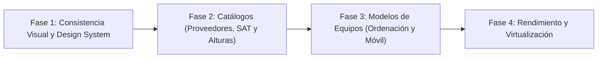

# Plan de Mejoras y Unificación de Tablas
**Proyecto:** Pulso Taller (`GestMant_TS`) — Sistema de Gestión de Mantenimiento  
**Versión del Plan:** 1.0.0  
**Fecha de Creación:** 2026-11-23  
**Estado:** Completado (Fases 1 a 4)  

---

## 1. Resumen Ejecutivo y Alcance

Tras auditar las **9 tablas** del panel (`InventoryTable`, `EquipmentTable`, `ManualsTable`, `UsersTable`, `CatalogsTable`, `EquipmentModelsTable`, `HistoryTable`, `PermissionsTable` y la tabla de `StockMovementsDialog`), este plan organiza en **4 fases incrementales** las mejoras de consistencia visual, usabilidad móvil/escritorio, ordenación y rendimiento sin romper invariantes arquitectónicas ni tests existentes.

---

## 2. Invariantes y Guardrails (`AGENTS.md`)

> [!IMPORTANT]
> - **Aislamiento de Capas:** Cualquier helper puro de ordenación o filtrado debe vivir en `src/lib/` o en `helpers.ts` locales sin importar React ni Convex (`tests/arquitectura.test.ts`).
> - **Vocabulario Ubicuo:** Mantener términos canónicos (**Equipo**, **Repuesto**, **Técnico**, **Incidencia**, **Petición de repuesto**).
> - **Finales de Línea:** Todo archivo guardado debe respetar LF (`tests/finalesDeLinea.test.ts`).
> - **Validación por Fase:** Al cerrar cada fase se ejecutará `npm run typecheck` y los tests afectados.

---

## 3. Hoja de Ruta por Fases

---

### Fase 1: Consistencia Visual y Design System
*Objetivo: Unificar la interacción de apertura de fichas laterales con `DetailTitleButton` y eliminar HTML crudo en tablas secundarias.*

- **Archivos a modificar:**
  - `src/pages/dashboard/equipment/components/EquipmentTableRow.tsx`
  - `src/pages/dashboard/manuals/components/ManualsTableRow.tsx`
  - `src/pages/dashboard/inventory/dialogs/StockMovementsDialog.tsx`
- **Acciones:**
  1. Sustituir el `<button>` manual del título en `EquipmentTableRow.tsx` y `ManualsTableRow.tsx` por `<DetailTitleButton>` (`src/components/DetailTitleButton.tsx`), garantizando foco accesible (`focus-visible:ring-2`), hover y truncado homogéneos con `PartRow` y `UserTableRow`.
  2. Migrar la tabla HTML nativa (`<table>`, `<thead>`, `<th>`) de `StockMovementsDialog.tsx` a los primitivos del sistema de diseño (`<Table>`, `<TableHeader>`, `<TableHead>`, `<TableBody>`, `<TableRow>`, `<TableCell>`) con cabecera `sticky`.
- **Verificación:**
  - `npm run typecheck`
  - `npx vitest run tests/detailTitleButton.test.tsx tests/equipmentSheetDialogs.test.tsx tests/stockMovements.test.ts`

---

### Fase 2: Mejoras en `CatalogsTable` (Proveedores, Empresas Externas/SAT y Altura)
*Objetivo: Aprovechar el espacio de la tabla de catálogos eliminando columnas internas sin valor operativo y haciendo accionables los datos de contacto.*

- **Archivos a modificar:**
  - `src/pages/dashboard/settings/catalogs/components/CatalogsTable.tsx`
  - `tests/catalogsCard.test.tsx`
- **Acciones:**
  1. Reemplazar la columna técnica `"Normalizado"` por:
     - **Contacto / Dirección** cuando el catálogo sea `Proveedores` (`supplier`) o `Empresas externas y SAT` (`externalWorkshop`).
     - **Actualizado** (fecha formateada) o columna compacta en el resto de catálogos.
  2. Hacer clicable el nombre del elemento en `Proveedores` y `Empresas externas y SAT` mediante `DetailTitleButton` para abrir directamente `EditCatalogItemDialog`.
  3. Convertir los teléfonos y correos de contacto en enlaces directos `tel:` y `mailto:` dentro de la celda.
  4. Ajustar `maxHeightClass` de `ListArea` (actualmente `max-h-[calc(100dvh_-_52rem)]`, demasiado restrictivo en pantallas de `768px–900px`) a una altura cómoda y responsiva (p. ej. `max-h-[55dvh] min-h-[16rem]`).
  5. Actualizar la aserción de cabeceras en `tests/catalogsCard.test.tsx` para reflejar las nuevas columnas.
- **Verificación:**
  - `npm run typecheck`
  - `npx vitest run tests/catalogsCard.test.tsx tests/catalogs.test.ts tests/workshopSettingsView.test.tsx`

---

### Fase 3: Ordenación y Vista Móvil en `EquipmentModelsTable`
*Objetivo: Equiparar la tabla de modelos de equipos (`Ajustes → Modelos`) al resto de tablas principales en ordenación, legibilidad móvil y altura.*

- **Archivos a modificar:**
  - `src/pages/dashboard/settings/equipmentModels/` (`EquipmentModelsTable.tsx`, `EquipmentModelsCard.tsx`, `helpers.ts`, hook de estado correspondiente)
  - `tests/equipmentModelsCardHelpers.test.ts` (o test equivalente)
- **Acciones:**
  1. Integrar `SortableTableHead` y `TableSortBar` (`useTableSort` + `sortRows` de `src/lib/tableSort.ts`) para ordenar por **Marca**, **Modelo**, **Categoría**, **Preventivo** y **Uso** (total de equipos/repuestos/manuales vinculados).
  2. Replicar debajo del modelo en pantallas pequeñas (`md:hidden` / `lg:hidden`) la categoría y la periodicidad preventiva que actualmente desaparecen con `hidden md:table-cell` y `hidden lg:table-cell`.
  3. Usar `DetailTitleButton` en el nombre del modelo para abrir su edición de forma directa.
  4. Ajustar `maxHeightClass="max-h-[calc(100dvh_-_48rem)]"` para evitar recorte excesivo en portátiles.
- **Verificación:**
  - `npm run typecheck`
  - `npx vitest run tests/equipmentModels.test.ts tests/equipmentModelsCardHelpers.test.ts tests/tableSort.test.ts`

---

### Fase 4: Rendimiento y Escalabilidad (`ManualsTable`, `PartRow` e `HistoryTable`)
*Objetivo: Evitar degradación de renderizado cuando crezcan los catálogos de manuales, repuestos e histórico de compras.*

- **Archivos a modificar:**
  - `src/pages/dashboard/manuals/components/ManualsTable.tsx`
  - `src/pages/dashboard/manuals/components/ManualsTableRow.tsx`
  - `src/pages/dashboard/inventory/components/PartRow.tsx`
  - `src/pages/dashboard/purchasing/components/history/HistoryTable.tsx`
  - `src/pages/dashboard/purchasing/components/history/HistoryTableRow.tsx`
- **Acciones:**
  1. Envolver `PartRow` y `ManualsTableRow` en `React.memo` (igual que `EquipmentTableRow` y `UserTableRow`) para evitar re-renders innecesarios al abrir diálogos o cambiar estado en el contenedor padre.
  2. Añadir `useVirtualRows` en `ManualsTable` (compartiendo la referencia de scroll de `ListArea` igual que `InventoryTable` y `EquipmentTable`).
  3. Añadir virtualización (`useVirtualRows`) o paginación (`useTablePagination` + `TablePagination`) en `HistoryTable` (`Compras → Histórico`), manteniendo intacta la selección de celdas/filas y la exportación CSV/portapapeles.
- **Verificación:**
  - `npm run typecheck`
  - `npx vitest run tests/purchasingHistoryTable.test.tsx tests/purchasingHistorySelection.test.tsx tests/purchasingHistoryFilters.test.tsx tests/longLists.test.ts tests/arquitectura.test.ts tests/seguridad.test.ts`
