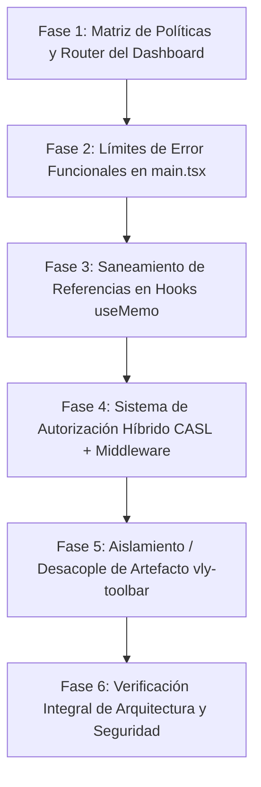

# Plan de Modernización y Refactorización de Arquitectura
**Proyecto:** Pulso Taller (`GestMant_TS`) — Sistema de Gestión de Mantenimiento  
**Versión del Plan:** 1.1.0 (Incluye Arquitectura de Autorización Híbrida CASL + Middleware Convex)  
**Fecha de Actualización:** 2026-10-23  
**Estado:** Listo para ejecución  

---

## 1. Resumen Ejecutivo y Objetivos

Este plan establece la hoja de ruta técnica para modernizar la arquitectura de Pulso Taller, erradicar deuda técnica heredada, estabilizar el ciclo de renderizado en React 19 y transformar el sistema de permisos básico actual en un modelo robusto de **Control de Acceso Híbrido (RBAC + ABAC basado en propiedad y contexto)** con auditoría centralizada.

### Objetivos Principales:
1. **Modernizar el Enrutador del Dashboard:** Reemplazar el `switch` procedimental por una matriz declarativa de políticas con tipado exhaustivo (`satisfies`) y precarga de vistas (`prefetchTab`).
2. **Erradicar Componentes de Clase Residuales:** Sustituir `ToolbarErrorBoundary` y `RootErrorBoundary` en [src/main.tsx](file:///e:/Users/kaoti/Documentos/GitHub/repuestos-taller-web/src/main.tsx) por límites de error funcionales modernos.
3. **Evolucionar Autorización a RBAC + ABAC Isomórfico (CASL + Middleware Convex):** Superar el modelo plano de booleanos introduciendo `@casl/ability` en el dominio y middlewares tipados en Convex con registro automático en `securityAuditLog`.
4. **Resolver Inestabilidad en Hooks de Estado:** Corregir las 34 advertencias de ESLint (`react-hooks/exhaustive-deps`) causadas por fallbacks inestables `?? []` evaluados antes de `useMemo`.
5. **Eliminar Artefactos Huérfanos:** Desacoplar [vly-toolbar-readonly.tsx](file:///e:/Users/kaoti/Documentos/GitHub/repuestos-taller-web/vly-toolbar-readonly.tsx) y dependencias residuales para sanear el Fast Refresh y reducir el bundle.

---

## 2. Invariantes y Guardrails de Gobernanza (`AGENTS.md`)

Antes y durante cada fase de implementación, se deben garantizar las siguientes reglas innegociables:

> [!IMPORTANT]
> - **Aislamiento de Dominio:** Ningún archivo en [src/lib/](file:///e:/Users/kaoti/Documentos/GitHub/repuestos-taller-web/src/lib/) puede importar `@convex-dev/*`, `convex/*`, `react` o `react-dom`. La definición de habilidades de CASL debe residir en `src/lib/abilities.ts` como código puro TypeScript.
> - **Máquinas de Estado:** Las transiciones de estado de **Incidencias**, **Peticiones de repuesto** u **Órdenes de compra** deben invocar siempre los flujos de dominio ([incidentFlow.ts](file:///e:/Users/kaoti/Documentos/GitHub/repuestos-taller-web/src/lib/incidentFlow.ts), [requestFlow.ts](file:///e:/Users/kaoti/Documentos/GitHub/repuestos-taller-web/src/lib/requestFlow.ts), [purchaseFlow.ts](file:///e:/Users/kaoti/Documentos/GitHub/repuestos-taller-web/src/lib/purchaseFlow.ts)).
> - **Vocabulario Ubicuo:** Utilizar con rigor: **Incidencia**, **Equipo**, **Petición de repuesto**, **Parte de trabajo**, **Técnico**.
> - **Inmutabilidad de Auditoría:** Prohibido alterar la persistencia o vaciar la tabla `securityAuditLog`. Toda denegación de mutación debe auditarse.

---

## 3. Fases de Implementación (Estrategia Strangler Fig)



---

### Fase 1: Matriz Declarativa y Modernización del Router de Pestañas
- **Archivos a modificar:**
  - [src/pages/dashboard/components/content/router/helpers.ts](file:///e:/Users/kaoti/Documentos/GitHub/repuestos-taller-web/src/pages/dashboard/components/content/router/helpers.ts)
  - [src/pages/dashboard/components/content/router/lazyViews.ts](file:///e:/Users/kaoti/Documentos/GitHub/repuestos-taller-web/src/pages/dashboard/components/content/router/lazyViews.ts)
  - [src/pages/dashboard/components/content/router/DashboardTabRenderer.tsx](file:///e:/Users/kaoti/Documentos/GitHub/repuestos-taller-web/src/pages/dashboard/components/content/router/DashboardTabRenderer.tsx)
  - [tests/dashboardTabRouterRules.test.ts](file:///e:/Users/kaoti/Documentos/GitHub/repuestos-taller-web/tests/dashboardTabRouterRules.test.ts)

- **Acciones específicas:**
  1. Reemplazar la sentencia `switch (tab)` en `helpers.ts` por `TAB_ACCESS_POLICY` tipada con `as const satisfies Record<NavId, TabAccessRule>`.
  2. Implementar funciones auxiliares de precarga de módulo (`prefetchTab(tab: NavId)`) en `lazyViews.ts`.
  3. Ejecutar suite de pruebas:
     ```bash
     npx vitest run tests/dashboardTabRouterRules.test.ts
     ```

---

### Fase 2: Erradicación de Componentes de Clase en `main.tsx`
- **Archivos a modificar:**
  - [src/main.tsx](file:///e:/Users/kaoti/Documentos/GitHub/repuestos-taller-web/src/main.tsx)
  - [src/components/ModuleErrorBoundary.tsx](file:///e:/Users/kaoti/Documentos/GitHub/repuestos-taller-web/src/components/ModuleErrorBoundary.tsx)

- **Acciones específicas:**
  1. Eliminar `ToolbarErrorBoundary` y `RootErrorBoundary` (clases de React 16).
  2. Sustituir por un componente de captura moderno o reutilizar `ModuleErrorBoundary` para garantizar que errores en renderers no dejen la pantalla en blanco sin degradar Fast Refresh.
  3. Verificar que la inicialización de `ConvexAuthProvider`, `BrowserRouter` y los fallbacks de carga sigan funcionando sin interrupciones.

---

### Fase 3: Saneamiento de Referencias en Hooks de Estado (`useMemo`)
- **Archivos a modificar:**
  - [src/pages/dashboard/equipment/dialogs/useEquipmentForm.ts](file:///e:/Users/kaoti/Documentos/GitHub/repuestos-taller-web/src/pages/dashboard/equipment/dialogs/useEquipmentForm.ts)
  - [src/pages/dashboard/equipment/hooks/useEquipmentDerivedData.ts](file:///e:/Users/kaoti/Documentos/GitHub/repuestos-taller-web/src/pages/dashboard/equipment/hooks/useEquipmentDerivedData.ts)
  - [src/pages/dashboard/equipment/hooks/useEquipmentListState.ts](file:///e:/Users/kaoti/Documentos/GitHub/repuestos-taller-web/src/pages/dashboard/equipment/hooks/useEquipmentListState.ts)
  - [src/pages/dashboard/settings/catalogs/hooks/useCatalogsState.ts](file:///e:/Users/kaoti/Documentos/GitHub/repuestos-taller-web/src/pages/dashboard/settings/catalogs/hooks/useCatalogsState.ts)
  - [src/pages/dashboard/settings/equipmentModels/hooks/useEquipmentModelsState.ts](file:///e:/Users/kaoti/Documentos/GitHub/repuestos-taller-web/src/pages/dashboard/settings/equipmentModels/hooks/useEquipmentModelsState.ts)

- **Acciones específicas:**
  1. Identificar expresiones lógicas como `const catalogModels = rawCatalogModels ?? []` ubicadas en el cuerpo del componente antes del hook.
  2. Mover la inicialización con fallback al interior de la función de cálculo del `useMemo`, o declarar un array congelado estático (`const EMPTY_ARRAY = Object.freeze([])`).
  3. Comprobar que `npm run lint` reduce drásticamente las advertencias de dependencias exhaustivas.

---

### Fase 4: Modernización de la Autorización (CASL + Middleware Convex)

#### A. Definición de Habilidades Puras en Dominio (`src/lib/abilities.ts`)
- **Dependencias autorizadas:** `@casl/ability` (motor puro de reglas en memoria, compatible con runtime V8 de Convex y React 19).
- **Alcance:**
  - Crear motor isomórfico capaz de evaluar reglas basadas en atributos y propiedad:
    - Un **Técnico** puede editar una **Incidencia** si está asignada a él (`{ assignedToId: user._id }`).
    - Una **Incidencia** no puede modificarse si su estado es `resolved` o `archived` (alineado con `incidentFlow.ts`).
    - Un **Gestor** puede aprobar peticiones de material (`Request`) según límites de importe o estado (`{ status: "pending" }`).

#### B. Middleware Declarativo en Convex (`src/convex/_auth/secureMutation.ts`)
- Centralizar la comprobación de identidad y permisos mediante wrappers de mutaciones:
  ```typescript
  export const secureMutation = <Args extends PropertyValidators>(config: {
    capability?: Capability;
    auditEvent?: string;
  }) => customMutation(mutation, { ... });
  ```
- Auditoría automática: si un usuario intenta invocar una mutación sin los privilegios requeridos, se emite inmediatamente un registro en `securityAuditLog` y se rechaza la operación con `ConvexError`.

#### C. Integración en UI con `@casl/react`
- Integrar hook `useAbility()` y componente declarativo `<Can I="update" this={incident}><Button>Cerrar Incidencia</Button></Can>` en vistas del Dashboard, garantizando sincronía exacta entre la UI y el backend.

---

### Fase 5: Desacoplamiento de Artefactos de Prototipado
- **Archivos a revisar / modificar:**
  - [vly-toolbar-readonly.tsx](file:///e:/Users/kaoti/Documentos/GitHub/repuestos-taller-web/vly-toolbar-readonly.tsx)
  - [src/lib/vly-integrations.ts](file:///e:/Users/kaoti/Documentos/GitHub/repuestos-taller-web/src/lib/vly-integrations.ts)
  - [src/main.tsx](file:///e:/Users/kaoti/Documentos/GitHub/repuestos-taller-web/src/main.tsx)
  - [vite.config.ts](file:///e:/Users/kaoti/Documentos/GitHub/repuestos-taller-web/vite.config.ts)

- **Acciones específicas:**
  1. Condicionar la importación de la barra de previsualización para que únicamente se cargue en modo desarrollo si la variable de entorno está presente.
  2. Eliminar las exportaciones mixtas que disparan avisos de Fast Refresh.
  3. Verificar que `vite build` genera los chunks limpios sin referencias huérfanas.

---

### Fase 6: Arnés de Pruebas y Validación Exhaustiva

Ejecutar la suite completa de verificación en el siguiente orden:

```bash
# 1. Verificación estricta de tipos de TypeScript
npx tsc --noEmit

# 2. Análisis estático y reglas de linting
npm run lint

# 3. Test de Arquitectura y Aislamiento de Capas
npx vitest run tests/arquitectura.test.ts

# 4. Test de Seguridad y Guardrails de AppSec
npx vitest run tests/seguridad.test.ts

# 5. Suite completa de pruebas unitarias y de integración
npx vitest run

# 6. Compilación de producción
npm run build
```

---

## 4. Matriz de Riesgos y Procedimiento de Rollback

| Riesgo Potencial | Impacto | Estrategia de Mitigación | Plan de Rollback |
|---|---|---|---|
| Incompatibilidad en dependencias de `useMemo` | Medio (Re-renders o datos desactualizados) | Pruebas unitarias de los hooks afectados con `@testing-library/react` antes de fusionar. | Restaurar la versión anterior del hook mediante git checkout del archivo específico. |
| Fallo en la política CSP al alterar `main.tsx` o `vite.config.ts` | Alto (Bloqueo de conexión WebSocket con Convex) | Ejecutar `tests/cspSecurity.test.ts` y validar generación de `pulso-csp.txt`. | Revertir inmediatamente cualquier cambio en la inyección de `API_CSP_TOKEN`. |
| Regresión en permisos de acceso al Dashboard | Alto (Técnicos sin acceso a módulos o invitados viendo datos) | Suite `tests/dashboardTabRouterRules.test.ts` ejecutada de forma continua. | Revertir [helpers.ts](file:///e:/Users/kaoti/Documentos/GitHub/repuestos-taller-web/src/pages/dashboard/components/content/router/helpers.ts) a su versión con switch. |
| Denegación indebida de mutaciones al introducir Middleware / CASL | Alto (Operaciones bloqueadas en producción) | Despliegue en modo paralelo (*Shadow Authorization* o fallback permisivo logueado) antes de forzar bloqueo estricto. | Desactivar temporalmente el interceptor delegando en las comprobaciones `hasCapability` históricas. |
| Violación del guardrail de `src/lib/` al instalar `@casl/ability` | Crítico (Fallo de `tests/arquitectura.test.ts`) | Comprobar que `src/lib/abilities.ts` no importe paquetes de React o Convex. CASL es agnóstico y pasa el test de pureza. | Mover adaptadores de framework fuera de `src/lib/` (ej. en `src/hooks/useAbility.ts`). |
